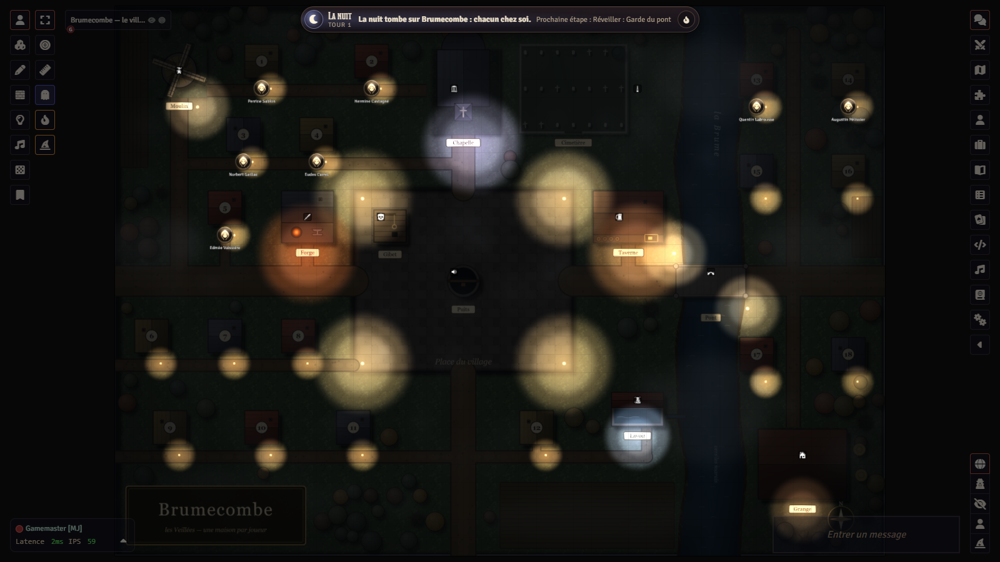
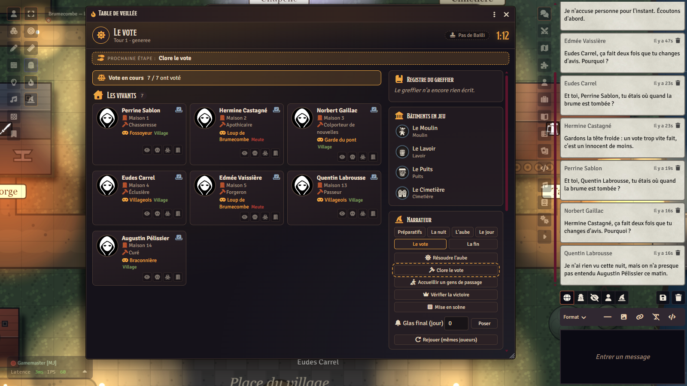
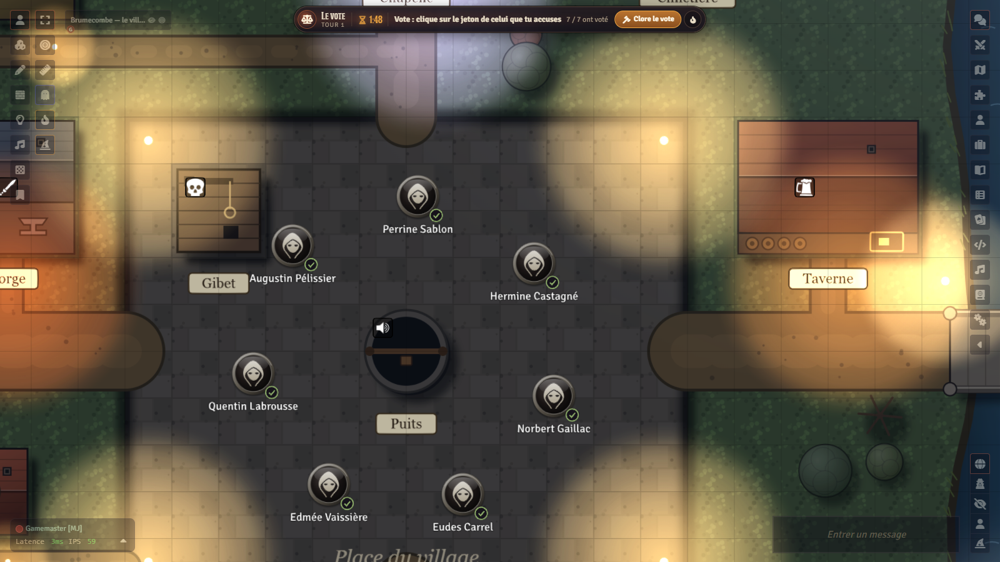
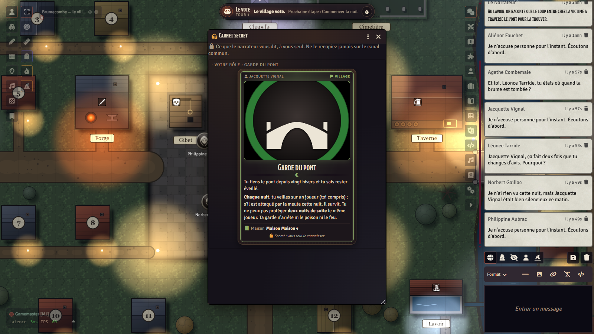
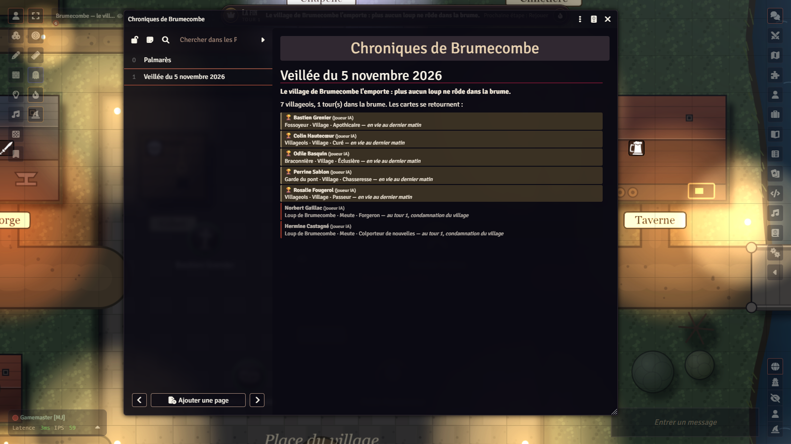

# Les Veillées de Brumecombe — The Vigils of Brumecombe

*An original social-deduction game of the werewolf family, for Foundry VTT.*

[Version française](README.md) · [Changelog](CHANGELOG.md) · [Credits](modules/lakour-veillees/CREDITS.md)

> **First time? Follow the [tutorial](TUTORIAL.md)**: from installation to your first vigil (player accounts and
> passwords, the vault backup key, voice, the AI GM, troubleshooting).

<p align="center">
  
  
</p>
<p align="center">
  
  
  
</p>

Brumecombe is a village at the bottom of a valley, cut off from the world every autumn by a fog so thick you cannot see your
own hand. Eighteen houses with closed shutters, a chapel, a mill, a tavern, a stone bridge over the river. And this autumn,
some of you are wolves: by day they talk, vote and mourn with everyone else; by night they enter the houses. The village has
one weapon: words, and the vote.

> **Language note.** The interface of the system and of the content module is available in **French and English**. The
> game content itself (roles, trades, buildings, guides, variants, tables, holiday journals) exists in both languages:
> `lakour-veillees` is the French module; **`lakour-veillees-en`** is the English edition, generated from the same sources
> and the translation dictionaries in `modules/lakour-veillees/contenu/en/` (`npm run fabriquer-veillees-en`). Same
> documents, same identifiers: enable only one of the two. Manifest: `releases/latest/download/lakour-veillees-en.json`.
> The English role names are original creations (Ash Reader, Lantern Keeper, Lady of the Ford…); the keys the system reads
> (map landmarks such as “Maison 1” or “Chapelle”, setups, balance) stay as they are. The narrator (human or AI) can narrate
> in any language.

## In short

**Les Veillées de Brumecombe** is a complete, original game: its roles, trades, buildings, texts, map and images are its
own. It uses the free mechanisms of the genre (a village, hidden wolves, secret nights, votes in broad daylight) and nothing
else: *nothing is taken from Les Loups-garous de Thiercelieux (a trademark of its publishers) nor from any other commercial
game*.

It is played **in Foundry VTT**, online, with **6 to 18 players**, in an evening (a game lasts from twenty minutes to an hour
and a half depending on the size of the table). It can be run two ways:

- **with a human narrator**: the system does the tedious part (set-up, secret role distribution, night order, dawn
  resolution, timer, vote, tally) and the narrator does what a human does best: telling the story;
- **with the AI game master**: the narrator is an AI (Claude or ChatGPT, with your own key) that narrates, wakes the roles,
  runs the debate and tallies the votes; **AI companions** can take seats at the table like players, and the **Small table**
  mode lets 1 to 4 humans play with 2 to 8 AI players.

Either way, **no player has to give up their seat** to be the narrator, and **no secret ever goes through a player's
browser**: what they must not know is never sent to them.

**Transparency.** The code and the texts in this repository were written with the help of an AI (Claude, by
Anthropic) and reviewed by the author. The illustrations (world welcome screen, festive vigils) are AI-generated, locally
(FLUX.2 klein 9B in ComfyStudio); the village map and the tokens are not (see [Credits](#credits)).

This repository holds three pieces:

| Piece | Folder | What it is |
|---|---|---|
| the **system** `lakour-loups` | `systems/lakour-loups/` | the rules, the game table, the board, the votes, the secrets |
| the **content module** `lakour-veillees` | `modules/lakour-veillees/` | roles, trades, buildings, village map, guides, set-ups |
| the **shared engine** `lakour-mj-ia` | `modules/lakour-mj-ia/` (submodule) | the AI game master, the companions, the secrets vault ([its repository](https://github.com/Hogun974/lakour-mj-ia)) |

## Who it is for, what you need

- **6 to 18 players** (ready-made set-ups for every size, in three levels), or **4 to 12 seats** in Small table mode with AI
  players. A group of friends online, one evening, a microphone each.
- **Foundry VTT v14** (verified with 14.369). No game system to buy: the system is provided here.
- The **AI GM module** (`lakour-mj-ia`) is **required even without AI**: it keeps the encrypted vault of the game's secrets.
  Without an AI key it costs nothing and contacts nobody; voice and companions then run in "simple" mode (no AI) or stay off.
- Optional: Foundry's built-in A/V for automatic **voice rooms** (at night the wolves hear each other; the dead talk to the
  dead); a Claude or OpenAI key for the AI GM and the companions.

## Installation

Three ways, from the simplest to the most complete. In all three you need **the system, the content module and the AI GM
module**.

### 1. From Foundry, with the manifests (recommended)

In Foundry's setup screen, **Game Systems › Install System**, then paste the manifest URL:

```
https://github.com/Hogun974/lakour-veillees/releases/latest/download/system.json
```

Then **Add-on Modules › Install Module**, twice:

```
https://github.com/Hogun974/lakour-veillees/releases/latest/download/module.json
https://github.com/Hogun974/lakour-mj-ia/releases/latest/download/module.json
```

Create a world with the **Les Veillées de Brumecombe** system, enable both modules (**La Kour — Les Veillées de Brumecombe**
and **La Kour – MJ IA**), then accept the prompt to **install the content** (guides, variants, village map): Game Settings ›
La Kour — Les Veillées de Brumecombe › Install.

### 2. A ready-made empty world

A world that is already configured (system, modules enabled, content installed, village map in place) is published with each
release, as an archive: Foundry 14 no longer installs a world from a manifest URL (the **Game Worlds** tab only offers
**Create World**).

1. First install the system and both modules from their manifests (way 1): the world requires them.
2. Download `la-kour-veillees-en.zip` (English) or `la-kour-veillees.zip` (French) from the
   [latest release](https://github.com/Hogun974/lakour-veillees/releases/latest).
3. Unzip it into `Data/worlds/la-kour-veillees-en/` (or `Data/worlds/la-kour-veillees/`) inside Foundry's data folder
   (**Configuration › User Data Path**; on a hosting service, its file manager): `world.json` directly in that folder.
4. **Restart Foundry**: the world then appears in **Game Worlds**.

The world is empty: no game, no player, no chronicle.
Its only user, **Gamemaster**, has no password: **set one** (Configuration › Users) **before inviting anyone**, or any guest
can log in as GM.

### 3. From source

```bash
git clone --recurse-submodules https://github.com/Hogun974/lakour-veillees.git
cd lakour-veillees
npm install                  # @foundryvtt/foundryvtt-cli, pinned versions
npm run fabriquer-veillees   # checks the content, writes src/ then compiles the compendiums into packs/
```

The compiled compendiums (`modules/lakour-veillees/packs/`) **are not versioned**: they must be built. Then copy
`systems/lakour-loups/` to `Data/systems/lakour-loups/`, `modules/lakour-veillees/` to `Data/modules/lakour-veillees/`
(without `src/` and `contenu/`, which only serve the build) and `modules/lakour-mj-ia/` to `Data/modules/lakour-mj-ia/`
(without `essais/`, `outils/`, `docs/`, `package*.json`). `node outils/empaqueter-paquets.mjs` produces the same archives as a
release, in `dist/`.

## How a vigil is played

A vigil runs in **rounds**: a night, a dawn, a day, a vote, and night falls again, until one side wins.

**Set-up.** The narrator opens the **Game Table** (button in the left bar, token layer), picks the number of players and the
level (Beginners, Classic, Chaos, or Small table), lets the system compose a balanced game or takes a ready-made set-up, then
**deals**. Everyone receives a **role card** in secret and a **trade** in public; everyone has a **house** on the map
("House 1" to "House 18", six of them across the river). **The set-up stays secret**: neither the roles in play nor the
number of wolves are announced; only the **4 to 6 buildings** in play are, and each one changes a rule.

**Night.** Fog falls on the map, tokens go home, microphones go quiet (voice rooms: wolves hear each other, the dead hear each
other). The narrator wakes the roles **one by one, in order**: a **choice window** opens for the one player concerned ("Which
house do you light tonight?"); on the board the possible houses light up and **one click on a token** is enough. The wolves
wake together and choose their prey. The AI GM runs all of this alone; a human narrator follows the Table's **Night order**,
button after button.

**Dawn.** The system resolves the night (protections, remedies, locks, fire, poison, bite, harpoon, visits, lantern) and the
narrator tells what the village finds in the morning: who died, and sometimes how. Information roles get their answer in
their **secret notebook**. Depending on the setting, the roles of the dead are revealed or not; a dead player no longer talks
to the living, but may keep a **Last breath** (one vote, once).

**Day.** The village **debates**, on a timer (five minutes by default). **Day powers** (trades, Justice of the peace,
Storyteller, buildings) are played with one click on the Game Table: the system checks the timing, applies the effect and
announces it. On the first day the village **elects its Bailiff** (double vote, breaks ties). Anyone can have a **statement**
written into the **Clerk's register**, the public memory of the vigil.

**Vote.** The narrator opens the vote; everyone **clicks a token** (or a name in the vote window), may change their mind until
closing; you see who has voted, never for whom. The vote closes by itself when the timer ends. The most accused is executed,
unless the Justice of the peace cancels or the Weaver's ribbon grants a last minute of defence; tally bubbles appear on the
map, the register records every vote. Then night falls again.

**The end.** The Village wins when no wolf is left alive; the Pack, when it equals everyone else; loners and lovers have their
own conditions. The narrator reads the **end-of-game tale** (every role revealed) and the vigil joins the **Chronicles of
Brumecombe**, a journal everyone can read: the players' hall of fame, then each vigil. The next time the world is launched,
the village starts over.

The **player guide** (a world journal, readable by all) and the **narrator guide** (hidden from players) cover all of this,
and every building on the map is **pinned** to its rules page.

## The content

Roles are public: the player guide describes them all, as the genre requires. What is secret is who holds what.

### The Pack (8 roles)

Wolves recognise each other on the first night and hunt together; some wake a second time, alone.

| Role | Power |
|---|---|
| **Wolf of Brumecombe** | Each night, with the pack, picks the victim. |
| **Starving wolf** | Each night, as long as no wolf has died, kills a second victim alone. |
| **Disguised wolf** | Looks like a villager to every vision; loses the mask if he survives a vote that singled him out. |
| **Mother wolf** | Once per game, infects the pack's prey instead of killing it: it secretly becomes a wolf. |
| **Howling wolf** | Each night, silences a player for the next day's debate. |
| **Sniffing wolf** | Each night, sniffs a player and learns their side. |
| **Wolf of the reeds** | Each night, watches a house and learns whether its occupant acted. |
| **Pale wolf** | Hunts with the pack, but every other night devours one of its own alone; wins only if left the last one alive. |

### The Village (37 roles)

| Role | Power |
|---|---|
| **Villager** | No power, one vote. |
| **Lantern keeper** | Lights a house each night: a wolf who enters it is unmasked at dawn. |
| **Ash reader** | Each night, learns a player's role. |
| **Herbalist** | One remedy (saves the pack's victim) and one poison (kills), once each, both on the same night if she wishes. |
| **Bridge guard** | Protects one player per night from the pack, never the same twice in a row. |
| **Bell ringer** | Once per game, by day, rings the bell: the vote condemns two players. |
| **Gravedigger** | Each night, learns the exact role of a dead player. |
| **Poacher** | If she dies, she takes a player of her choice with her. |
| **Storyteller** | Once per game, forces two minutes of debate about one player, who cannot answer. |
| **Justice of the peace** | Once per game, cancels a vote: the village votes again. |
| **Child of the fog** | May spy on the pack at night and learn the wolves' names; if caught, she is the one the pack devours. |
| **Hermit** | Each night, learns the name of one player who acted, without knowing what they did. |
| **Messenger** | Each night, carries a secret message between two players. |
| **Matchmaker** | Binds two lovers on the first night, then plays with the village. |
| **Keeper of the keys** | Each night, locks a house: nobody gets in, nobody gets out. |
| **Dowser** | Every other night, learns whether two players are on the same side. |
| **Wolf-hunter** | Each night, learns a player's side; but he smells of wolf: every vision sees him as the pack's. |
| **Sleepwalker** *(on request)* | Believes he holds a vision role, but he dreams: his visions are false. |
| **Rose queen** *(on request)* | The village's pride: if the village executes her by vote, the Village loses at once. |
| **Night fisherman** | Once per game, throws his harpoon: the target dies at dawn unless protected. |
| **Plain Villager** | No power, but their card is turned face up from the deal: the whole village knows they are innocent. |
| **Greybeard** | The pack must attack him twice to kill him; if he falls at the village's hand, the villagers lose their powers. |
| **Whipping Boy** | If the vote ends in a tie, he is the one executed; he then chooses who will vote the next day. |
| **Village Innocent** | If the village votes against him, he is pardoned: his card is turned over, he stays, but no longer votes. |
| **Washerwomen** *(in pairs)* | Recognise each other on the first night, then meet every other night to confer. |
| **Woodcutters** *(in threes)* | Recognise each other on the first night, then meet every other night to confer. |
| **Ferret** | Each night, sniffs a player and their two neighbours: a wolf among them? If not, he loses his nose. |
| **Goose Girl** | Each morning, her geese honk if a wolf is one of her two neighbours. |
| **Stammering Clerk** | Once per game, right after a conviction, secretly calls for a second vote, without debate. |
| **Old Sergeant** | If the pack devours him, his old sword kills the first wolf to his left the following night. |
| **Magpie** | Each night, lays a black feather on a player: two more votes against them at the day's vote. |
| **Pilferer** | On the first night, may steal one of the two cards left in the middle and become that role; must do so if both are wolves. |
| **Mountebank** | Three roles are laid face up: each night, may play the power of one of them, each one only once. |
| **Woods child** | On the first night, chooses a model: as long as it lives, is on the Village side; if it dies, joins the pack. |
| **Mastiff** | On the first night, chooses for good to be a wolf (hunting with the pack) or a plain villager. |
| **Chambermaid** | When the vote eliminates a player, may reveal herself before their card is turned over and secretly take their role. |
| **Firebrand** | With The Village variant: once per game, sets fire to a building; if it is the house of the wolves' prey, the wolf to its right dies there. |

### The loners (8 roles)

| Role | Power and victory |
|---|---|
| **Revenant** | Wins if executed by the village. |
| **Peddler** | Secretly swaps roles with another player, once; wins with the new side. |
| **Bounty hunter** | Gets a target at the start: wins if the target is executed by day. |
| **Arsonist** | Douses one house per night; one night, sets fire to every doused house; wins alone. |
| **Lady of the ford** | Every other night, lures a player to the ford where they drown; the pack cannot kill her; wins alone. |
| **Will-o'-the-wisp** | The game begins with a day; if eliminated in the first round, wins alone; otherwise, becomes a plain villager. |
| **Hurdy-gurdy player** | Each night, charms two players; wins alone when every other living player is charmed. |
| **Zealot** | The village is split into two groups announced to all; wins alone if the whole other group is eliminated. |

### Passers-by (3 roles)

For a player who **joins mid-game**: the role is public, the side secret (drawn by the system), the power works once, by day.
**Knife grinder** (sharpens a house's lock), **Marmot showman** (sets his marmot on a doorstep), **Pilgrim** (prays on a doorstep and
learns the side). The village can exile them by vote; and any player may **leave the vigil** without dying or revealing
anything.

### Public trades (14)

Every player has one, known to all: a small day power, once per game, that feeds the debate without saying anything about
one's side. Blacksmith (a lock against the next wolf attack), Miller (how many wolves are still alive), Watchman (keeps a
player from visiting any house), Priest (blesses: cannot be silenced, speaks first), Huntress (did a player leave their house
last night?), Innkeeper (a bed at the Tavern), Apothecary (gives back a silenced voice), Newsmonger (a true but vague clue),
Weaver (a ribbon: one extra minute of defence when accused), Ferryman (a player sleeps across the river, out of reach but
unable to act), Tanner (fang marks on a body, or not), Schoolmistress (roll call: thirty seconds each), Chimney sweep (did a
house receive a visit?), Lock keeper (the pack cannot hunt across the river next night).

### Buildings (10, of which 4 to 6 per game)

Each is a place on the map and changes a rule: the **Chapel** (one player sheltered each night by a vote), the **Mill**
(counts living wolves), the **Tavern** (up to three sleepers protect each other, unless a wolf is among them), the **Gallows**
(absolute majority to execute), the **Well** (a dead player's last ten words, once), the **Forge** (a blade under the pillow
wounds and silences a wolf), the **Graveyard** (the side of the dead eventually comes out), the **Bridge** (houses 13 to 18 are
across the river; the pack never crosses two nights in a row), the **Washhouse** (a true but vague clue every morning), the
**Barn** (a hiding place where you can neither be found nor act).

### Ready-made set-ups (48)

- **Beginners, Classic, Chaos**: one set-up per size from 6 to 18 players (2 wolves up to 8 players, 3 up to 12, 4 up to 15,
  5 beyond; one fewer at the Beginners level; loners and special wolves by level), with its buildings.
- **Small table**: 4 to 12 seats, drawn by the system's generator with a fixed seed.
- The Game Table can also **compose** a balanced game for any number, or take a hand-written list of roles. Balance weights
  live in `modules/lakour-veillees/contenu/equilibre.mjs`.

### The map and the board

The **village of Brumecombe** map (42 × 30 squares, top-down, at night) is drawn by code: eighteen houses, the square, the
ten buildings, the river and its bridge, with two renderings (flat and raised) and ambient sounds. The **board** runs the
game without anyone touching anything: a **neutral** token (a hooded villager) per player while their role is hidden, in
front of their house at night, in a circle on the square by day, at the graveyard when dead; moves are animated, darkness
follows the phase, fog falls at night, the screen shakes on a death (client setting, honours `prefers-reduced-motion`). A
**banner** at the bottom tells everyone where they stand (phase, time left, role and trade, "your turn", Vote and "It's the
plague!" buttons, voice room state) and a soft **chime** signals when it is your turn. **Non-player villagers** (the priest,
the elder, the Vaudreys' dog…) and extras can bring the village to life.

## Variants

All are chosen at set-up, in the Game Table or the world settings; the Variants guide describes them.

| Variant | In one line |
|---|---|
| **Black plague** | Rarely (one game in thirty, or by the narrator's choice), there is **no wolf at all**: the fever kills each night, and its last victim picks the next from the grave. Anyone alive may shout "It's the plague!": true, the village wins; false, they hang for panic. |
| **The Bailiff** (default) | Elected on the first day; double vote, breaks ties and names a successor when dying. |
| **The Clerk's register** | The public memory: every vote, vote by vote, every death with its known cause, players' statements (three per day). |
| **Vigil masks** (default) | The pack secretly receives two or three Village roles absent from the game, which it may claim. |
| **Last breath** (default) | Each dead player keeps one vote, once, for an execution vote. |
| **Almanac of the fogs** | One omen per dawn (clear sky, frost, flood, fair, fog, knell, red moon, rumour, north wind, broken seal) that changes the rule of the day or of the next night. |
| **Final knell** | The day the vigil stops: if a wolf is still alive, the pack wins. |
| **Lucky star** | A beginner secretly protected on the first night. |
| **Passers-by** (default) | Join mid-game with a public role and a secret side; leave without dying; exile by vote. |
| **The dock** | Only the accused can be executed, tried one by one; each player accuses once a day. |
| **Mourning knell** | Each innocent executed rings the knell, and the pack gains a growing power. |
| **Saint Martin's night** | The short format: three more roles than players under the altar, one night, one vote, the end. |
| **Festive vigils** | A seasonal, illustrated variant at the narrator's choice: **Night of souls** (the dead whisper), **Winter vigil** (a gift that parries the first blow, snow that erases tracks), **Carnival of masks** (one vision deceived, a parade that shows an absent role), **Feast of the betrothed** (two sure allies, whom the pack has seen). |
| **The Village** | Public personalities (Tenant Farmers, Prior, Bonesetter, Schoolmaster, Oven-Keeper, Wigmaker, Alehouse Keeper, Provost, Squire) hold the village buildings: a power on top of their secret role; the others are Drifters. The Tenant Farmers choose the Bailiff. |
| **The Pact** (level) | The party game's setup: only its characters, without our buildings or trades; the level offered first. |
| **Party game variants** | **Candlelight vigil** (and its dreadful version), **Chain of Innocents** (the last one standing is condemned), **Whispering Wall** (anonymous sentences each night), **Two Faces** (a visible role and a secret allegiance, or two cards), **Grape Harvest** (one more wolf, tipsy powers), **The Thrall** (the pack's prey enthralled instead of dying). |
| **The Moon Gazette** | 31 Event cards, one read out every morning but the first by the last player eliminated (or every other morning, one in three; or at the narrator's choice): absences, flood, deadly touch, distrust, nightmare, executioner… With it, every character has **visible traits** (gender, age, spectacles, jewel, clogs, headdress, pipe, village or outlying farm), which the cards read. The **Town Crier**, named by the Bailiff, holds a few cards in hand; the **Stargazer** has the first dead questioned (séances). |
| **Small table** | 1 to 4 humans and 2 to 8 AI players: short pack, first night without a kill from two wolves up, humans never all wolves nor all on the same side, ties broken by lot, final knell set automatically. |
| **Sleepwalker, Rose queen** | On-request roles, added by hand by the narrator. |
| Settings | Reveal on death, the dead see everything, debate and vote length, night choice delay, chance of being spotted while spying, dead channel, voice rooms, chat announcements, "your turn" signal, reset on world launch. |

## How secrets are kept, in plain words

In an online werewolf game the temptation to open the browser console is strong. Here is exactly what you will find there:

- Foundry sends every browser all documents and all world settings, and every change to them. Whispers too: a chat message,
  whispered or not, reaches every browser; only its **display** is restricted to its recipients (checked in Foundry v14). So
  the system stores **no secret** there: no role on a sheet, no side, no night choice, no private chat message, no "secret"
  block in a villager's notes (it is removed on save). In the Vigils the AI GM whispers to GMs only, and only technical
  notices (error, budget reached, autopilot): never anything about roles, since every browser receives it.
- The complete game state **exists only on the narrator's side** (the active GM). In the console a player sees only **what
  concerns them**: the **public state** (phase, who has voted, closed results, deaths and public cause) and what the GM sends
  to them alone through the socket: their role card, their notebook, their choice windows, their vote, their voice-room line.
- The game's secrets are **encrypted** (AES-GCM 256 vault) with the AI GM module's key, which never leaves the narrator's
  browser. That key can be recovered only **by the GM** (their browser, or another connected GM handing it over) and with the
  **backup key** they exported. During the night nothing is written to the world: neither the number of wake-ups nor the
  moment of a choice can be read.
- **Voice rooms** are sorted at the source: at night a living player's voice goes to nobody (except a wolf's, to the wolves);
  the dead talk only to the dead; a spectator never hears the den. A silenced player can neither speak nor write during the
  debate.
- **The cursor and the "speaking" light are hidden at night.** Otherwise Foundry broadcasts everyone's activity to all
  (checked in Foundry v14): their cursor on the map, their pings, their ruler, their targets, and the voice "speaking"
  indicator. At night, and while a player makes a secret choice, none of this leaves their browser; at nightfall cursors
  vanish and speaking lights go out for everyone at the same moment. The GM stays visible: they should avoid pointing at a
  token during the night.
- **AI companions** do not cheat: each has its own context, restricted to what a player in its seat would know.
- An automated test (`essais/non-fuite.test.mjs`) sifts **everything each player receives** during complete games and checks
  that no role, side, choice or secret of another player appears before its public reveal.

What remains visible is what the rules make public: the rhythm of the phases, who has voted, announced deaths, revealed
roles. What is in **your** browser (your card, your notebook) is in the clear, for you. And **a GM sees everything**: any user
with the GM role, assistants included, can become the narrator and reopen the vault; give that role to the narrator only. The
empty world has a **Gamemaster user without a password**: **set a password on it before inviting anyone**, or any guest can
log in as GM. Details and limits are in `docs/loups-contrat.md` (§ 6, in French).

## The AI game master, in brief

The `lakour-mj-ia` module brings an **AI narrator** (Claude or ChatGPT, with your own key, stored in your browser only) and
everything around it:

- it composes a balanced game, deals in secret, **runs the nights**, tells the dawn, drives the debate, opens and tallies the
  votes, reads the end-of-game tale; the recommended personality is *La Voix de la brume*;
- the narrator's **voice** (browser, free; or OpenAI, live) and **listening** to the players;
- **AI companions**: villagers played by the AI like players, each with its own mind and personality, who choose at night,
  coordinate as a pack, accuse, defend and vote; they also work without an AI GM session, with a human narrator ("+ AI
  player" button of the Table);
- the **autopilot**: when only AIs are left, the game goes on by itself, step by step, in front of the spectators, with its
  safeguards;
- a **budget per session** and a "validation" mode where every sensitive action waits for the human GM's approval; a
  **dummy** provider to try everything with no key and no cost.

The full guide is installed in the world by the module (journals "MJ IA — Guide du MJ" and "Guide des joueurs") and can be
read in [its repository](https://github.com/Hogun974/lakour-mj-ia).

## Tests

**505 Node tests** (`node --test`), no network, no cost, six to seven minutes: the system's pure logic (set-up, dealing,
night, dawn, votes, victory, every variant), its API, mutations (every broken rule must be caught), secret non-leakage, the
content contract, set-ups, map, tokens, companions, and complete simulated games to victory for every level and table size.

```bash
npm run essais               # every test of the repository
npm run contrat              # the shared contract of content modules (extras, token index, plans)
npm run valider -- <folder of a Foundry v14 installation>   # Foundry schemas, 0 errors expected
```

## Repository layout

```
systems/lakour-loups/         the system: logique/ (pure, tested in Node), scripts/ (Foundry), templates/, styles/, lang/
modules/lakour-veillees/      the content module: contenu/*.mjs = source of truth; src/ and assets/ built;
                              packs/ compiled (not versioned); scripts/main.js = installer; CREDITS.md
modules/lakour-mj-ia/         submodule: the shared engine (AI GM, companions, vault, build tools)
monde/                        the empty world published with each release (world.json, src/)
outils/                       fabriquer-veillees.mjs (content, compendiums), fabriquer-jetons-veillees.mjs (SVG tokens),
                              empaqueter-paquets.mjs (release archives)
essais/                       the Node tests of this repository, with their Foundry doubles
docs/                         loups-contrat.md (the contract between system, content and AI GM), plan-loup-garou.md,
                              publication.md, captures/
.github/workflows/            release.yml: release on v* tags
```

## Contributing

Feedback, bug reports and ideas are welcome in the [issues](https://github.com/Hogun974/lakour-veillees/issues). To propose a
change:

- **content** is edited in `modules/lakour-veillees/contenu/*.mjs` (never in `src/` or `packs/`, which are built), then
  `npm run fabriquer-veillees` and `npm run essais`;
- the system's **logic** lives in `systems/lakour-loups/logique/`: pure functions, no Foundry, each with its tests;
  `scripts/` only wires them to Foundry;
- the **contract** `docs/loups-contrat.md` is the single source of truth for exchanges between the three pieces: update it
  with the code;
- nothing specific to this game goes into the shared engine `lakour-mj-ia`, and nothing of the engine is fixed here (parity
  rule: an engine improvement serves every world that uses it);
- everything is in French (code, comments, texts), with interface labels translated into English;
- nothing taken from a published game: no text, no map, no role list; a test rejects any mention of *Thiercelieux* in the
  content.

## Credits

- Game, texts, rules, map and code: **Jordan (La Kour)**, written with the help of an AI (**Claude**, by Anthropic) and
  reviewed by the author.
- Token silhouettes: icons from **[game-icons.net](https://game-icons.net)** (Caro Asercion, Cathelineau, DarkZaitzev,
  Delapouite, Lorc, Skoll), **CC BY 3.0** licence, recoloured and set in a medallion; the icon-by-icon list is in
  [`modules/lakour-veillees/CREDITS.md`](modules/lakour-veillees/CREDITS.md).
- Illustrations (world welcome screen, festive vigils): **AI-generated**, locally by the author (FLUX.2 klein 9B in
  ComfyStudio), without any remote service.
- Village map: drawn by code, no external image. Ambient sounds: synthesised loops from the shared engine.
- **An original game of the werewolf family** (social-deduction games born from the traditional game *Mafia*): nothing is
  taken from *Les Loups-garous de Thiercelieux* (a trademark of its publishers) nor from any other commercial game.

## Licence

- **The code** (the `lakour-loups` system, scripts, templates, `lang/`, tools, tests, `docs/`): **MIT** licence, see
  [`LICENSE`](LICENSE) (© 2026 Hogun974).
- **Original texts and images** (roles, trades, buildings, guides, variants, tables: `contenu/` and its English
  dictionaries, the `src/` and `packs/` compendiums, the English module `lakour-veillees-en`, the blank world `monde/`;
  map, illustrations and tokens in `assets/`): [**CC BY-NC-SA 4.0**](https://creativecommons.org/licenses/by-nc-sa/4.0/)
  (attribution, non-commercial, share-alike). Expected attribution: "LaKour — Hogun974", with a link to this repository
  and to the licence.

The folder-by-folder details and the third-party notices are in [`LICENCE-CONTENU.md`](LICENCE-CONTENU.md); both files
ship in the system, module and world archives.

The game-icons.net icons (token silhouettes) keep their own CC BY 3.0 licence. Foundry VTT is a trademark of Foundry
Gaming LLC; this project is not affiliated with it.
