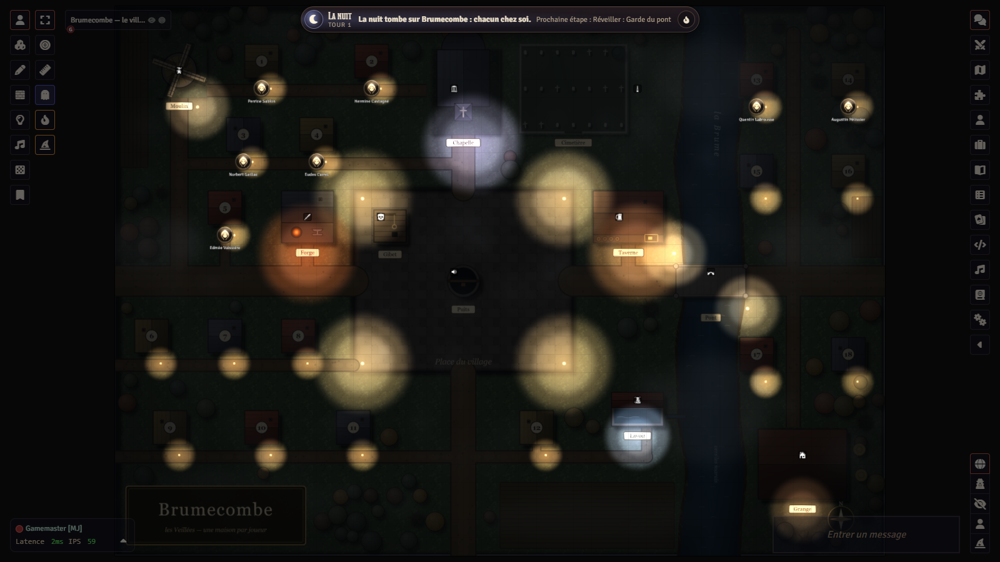
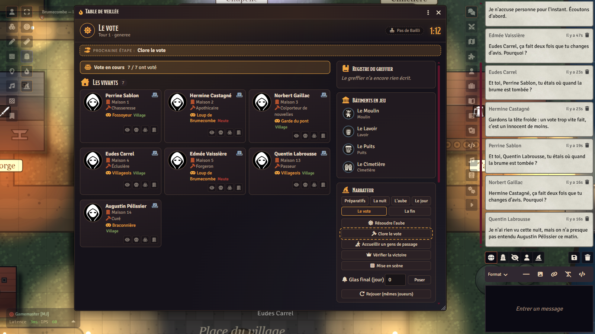
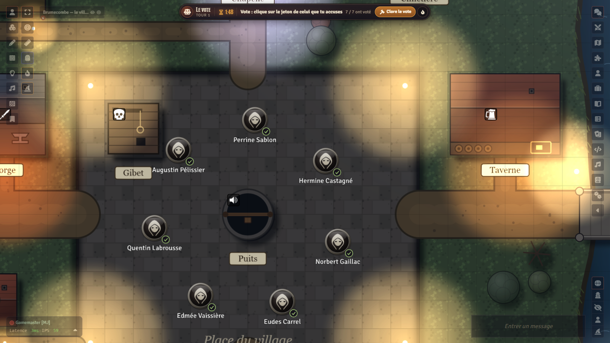
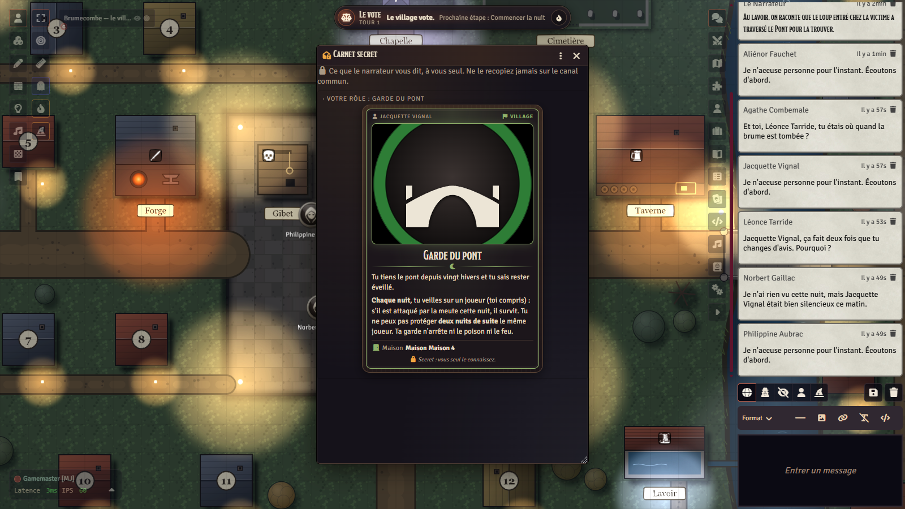
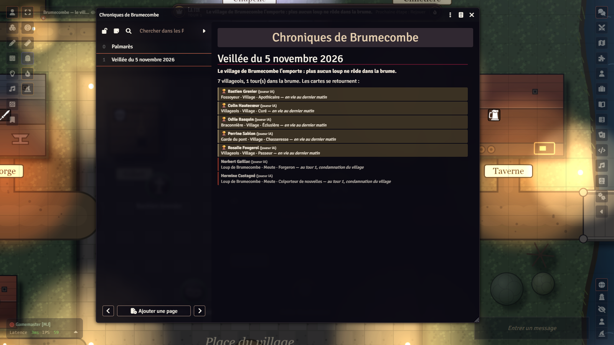

# Les Veillées de Brumecombe

*Un jeu original de déduction sociale, de la famille du loup-garou, pour Foundry VTT.*

[English version](README.en.md) · [Changements](CHANGELOG.md) · [Crédits](modules/lakour-veillees/CREDITS.md)

> **Première fois ? Suivez le [tutoriel](TUTORIEL.md)** : de l'installation à la première veillée (comptes et mots de
> passe des joueurs, clé de secours du coffre, voix, MJ IA, dépannage).

<p align="center">
  
  
</p>
<p align="center">
  
  
  
</p>

Brumecombe est un village de fond de vallée, coupé du monde chaque automne par une brume si épaisse qu'on n'y voit pas sa
propre main. Dix-huit maisons aux volets clos, une chapelle, un moulin, une taverne, un pont de pierre sur la rivière. Et cet
automne, certains des vôtres sont des loups : le jour, ils parlent, votent et pleurent avec les autres ; la nuit, ils entrent
dans les maisons. Le village n'a qu'une arme : la parole, et le vote.

## En deux mots

**Les Veillées de Brumecombe** est un jeu complet et original : ses rôles, ses métiers, ses bâtiments, ses textes, sa carte et
ses images sont à lui. Il reprend les mécanismes libres du genre (un village, des loups cachés, des nuits secrètes, des votes
au grand jour) et rien d'autre : *aucune reprise des Loups-garous de Thiercelieux (marque de ses éditeurs) ni d'un autre jeu
commercial*.

Il se joue **dans Foundry VTT**, à distance, de **6 à 18 joueurs**, en une soirée (une partie dure de vingt minutes à une
heure et demie selon la taille de la table). Il se mène de deux façons :

- **avec un narrateur humain** : le système fait tout le travail ingrat (composition, distribution secrète, ordre de nuit,
  résolution de l'aube, minuteur, vote, dépouillement) et le narrateur fait ce qu'un humain fait mieux : raconter ;
- **avec le MJ IA** : le narrateur est une IA (Claude ou ChatGPT, avec votre propre clé) qui raconte, réveille les rôles,
  anime le débat et dépouille ; des **compagnons IA** peuvent tenir des places à la table, comme des joueurs, et le mode
  **Petite tablée** permet de jouer à 1 à 4 humains complétés par 2 à 8 joueurs IA.

Dans les deux cas, **aucun joueur n'a à sacrifier sa place** pour être meneur, et **aucun secret ne passe par le navigateur
d'un joueur** : ce qu'il ne doit pas savoir ne lui est jamais envoyé.

**Transparence.** Le code et les textes de ce dépôt ont été écrits avec l'aide d'une IA (Claude, d'Anthropic) et relus par
l'auteur. Les illustrations (écran d'accueil du monde, veillées de fête) sont générées par IA, localement (FLUX.2 klein
9B dans ComfyStudio) ; la carte du village et les jetons ne le sont pas (voir [Crédits](#crédits)).

Ce dépôt contient trois pièces :

| Pièce | Dossier | Ce que c'est |
|---|---|---|
| le **système** `lakour-loups` | `systems/lakour-loups/` | les règles, la Table de jeu, le plateau, les votes, les secrets |
| le **module de contenu** `lakour-veillees` | `modules/lakour-veillees/` | rôles, métiers, bâtiments, carte du village, guides, compositions |
| le **moteur commun** `lakour-mj-ia` | `modules/lakour-mj-ia/` (sous-module) | le MJ IA, les compagnons, le coffre des secrets ([son dépôt](https://github.com/Hogun974/lakour-mj-ia)) |

## Pour qui, avec quoi

- **De 6 à 18 joueurs** (compositions prêtes pour chaque taille, en trois niveaux), ou **4 à 12 places** en Petite tablée avec
  des joueurs IA. Un groupe d'amis à distance, une soirée, un micro chacun.
- **Foundry VTT v14** (vérifié avec la 14.369). Aucun système de jeu à acheter : le système est fourni ici.
- Le module **MJ IA** (`lakour-mj-ia`) est **requis même sans IA** : c'est lui qui tient le coffre chiffré des secrets de la
  partie. Sans clé d'IA, il ne coûte rien et ne contacte personne ; la voix et les compagnons restent alors « simples »
  (sans IA) ou désactivés.
- Facultatif : la voix intégrée de Foundry (A/V) pour les **salons vocaux** automatiques (la nuit, les loups s'entendent entre
  eux ; les morts parlent aux morts) ; une clé Claude ou OpenAI pour le MJ IA et les compagnons.

## Installation

Trois façons, de la plus simple à la plus complète. Dans les trois cas, il faut **le système, le module de contenu et le
module MJ IA**.

### 1. Depuis Foundry, par les manifestes (recommandé)

Dans la configuration de Foundry, **Systèmes de jeu › Installer un système**, puis coller l'adresse du manifeste :

```
https://github.com/Hogun974/lakour-veillees/releases/latest/download/system.json
```

Puis **Modules › Installer un module**, deux fois :

```
https://github.com/Hogun974/lakour-veillees/releases/latest/download/module.json
https://github.com/Hogun974/lakour-mj-ia/releases/latest/download/module.json
```

Créer ensuite un monde avec le système **Les Veillées de Brumecombe**, y activer les deux modules (**La Kour — Les Veillées de
Brumecombe** et **La Kour – MJ IA**), puis suivre l'invitation à **installer le contenu** (guides, variantes, carte du
village) : Réglages du jeu › La Kour — Les Veillées de Brumecombe › Installer.

### 2. Un monde vierge, tout prêt

Un monde déjà configuré (système, modules actifs, contenu installé, carte du village en place) est publié avec chaque
version, en archive : Foundry 14 n'installe plus de monde par URL de manifeste (l'onglet **Mondes de jeu** ne propose que
**Créer un monde**).

1. Installez d'abord le système et les deux modules par leurs manifestes (façon 1) : le monde les exige.
2. Téléchargez `la-kour-veillees.zip` (ou `la-kour-veillees-en.zip` pour l'anglais) dans la
   [dernière version](https://github.com/Hogun974/lakour-veillees/releases/latest).
3. Décompressez-la dans `Data/worlds/la-kour-veillees/` (ou `Data/worlds/la-kour-veillees-en/`) du dossier de données de
   Foundry (**Configuration › Chemin des données** ; sur un hébergeur, son gestionnaire de fichiers) : `world.json`
   directement dans ce dossier.
4. **Redémarrez Foundry** : le monde apparaît alors dans **Mondes de jeu**.

Le monde est vierge : aucune partie, aucun joueur, aucune chronique. Son seul utilisateur, **Gamemaster**, n'a pas de mot de passe : **posez-lui-en un** (Configuration ›
Utilisateurs) **avant d'inviter qui que ce soit**, sinon n'importe quel invité peut entrer en MJ.

### 3. Depuis les sources

```bash
git clone --recurse-submodules https://github.com/Hogun974/lakour-veillees.git
cd lakour-veillees
npm install                  # @foundryvtt/foundryvtt-cli, versions épinglées
npm run fabriquer-veillees   # vérifie le contenu, écrit src/ puis compile les compendiums dans packs/
```

Les compendiums compilés (`modules/lakour-veillees/packs/`) **ne sont pas versionnés** : il faut les fabriquer. Copier ensuite
`systems/lakour-loups/` dans `Data/systems/lakour-loups/`, `modules/lakour-veillees/` dans `Data/modules/lakour-veillees/`
(sans `src/` ni `contenu/`, qui ne servent qu'à la fabrication) et `modules/lakour-mj-ia/` dans `Data/modules/lakour-mj-ia/`
(sans `essais/`, `outils/`, `docs/`, `package*.json`). `node outils/empaqueter-paquets.mjs` produit les mêmes archives que la
publication, dans `dist/`.

## Comment on joue

Une veillée se joue en **tours** : une nuit, une aube, un jour, un vote, et la nuit revient, jusqu'à la victoire d'un camp.

**La préparation.** Le narrateur ouvre la **Table de jeu** (bouton dans la barre de gauche, calque des jetons), choisit le
nombre de joueurs et le niveau (Débutants, Classique, Chaos, ou Petite tablée), laisse le système composer la partie ou prend
une composition prête, puis **distribue**. Chacun reçoit en secret une **carte de rôle** et, publiquement, un **métier** ; chacun
a sa **maison** sur la carte (« Maison 1 » à « Maison 18 », dont six sur l'autre rive). **La composition reste secrète** : ni les
rôles en jeu, ni le nombre de loups ne sont annoncés ; seuls les **4 à 6 bâtiments** en jeu le sont, et chacun change une règle.

**La nuit.** La brume tombe sur la carte, les jetons rentrent devant leur maison, les micros se taisent (salons vocaux : les
loups s'entendent entre eux, les morts entre eux). Le narrateur réveille les rôles **un par un, dans l'ordre** : une **fenêtre de
choix** s'ouvre chez le seul joueur concerné (« Quelle maison éclaires-tu cette nuit ? ») ; sur le plateau, les maisons
possibles s'allument et **un clic sur un jeton** suffit. Les loups se réveillent ensemble et choisissent leur proie. Le MJ IA
mène tout cela seul ; un narrateur humain suit l'**Ordre de nuit** de la Table, bouton après bouton.

**L'aube.** Le système résout la nuit (protections, remèdes, verrous, feu, poison, morsure, harpon, visites, lanterne) et le
narrateur raconte ce que le village découvre : qui est mort, et parfois comment. Les rôles d'information reçoivent leur
réponse dans leur **carnet secret**. Selon le réglage, le rôle des morts est révélé ou non ; un mort ne parle plus aux
vivants, mais peut garder un **Dernier souffle** (une voix, une seule fois) pour un vote.

**Le jour.** Le village **débat**, minuté (cinq minutes par défaut). Les **pouvoirs de jour** (métiers, Juge de paix, Conteuse,
bâtiments) se jouent d'un clic sur la Table de jeu : le système vérifie que c'est le bon moment, applique l'effet et
l'annonce. Le premier jour, le village **élit son Bailli** (voix double, il tranche les égalités). Chacun peut faire inscrire
une **déclaration** au **Registre du greffier**, la mémoire publique de la veillée.

**Le vote.** Le narrateur ouvre le vote ; chacun **clique sur un jeton** (ou un nom dans la fenêtre de vote), peut changer d'avis
jusqu'à la clôture ; on voit qui a voté, jamais pour qui. Le vote se clôt seul à la fin du minuteur. Le plus désigné est
exécuté, sauf annulation du Juge de paix ou ruban de la Tisserande ; les bulles du dépouillement s'affichent sur la carte, le
Registre note voix par voix. Puis la nuit revient.

**La fin.** Le Village gagne quand plus aucun loup ne vit ; la Meute, quand elle est aussi nombreuse que les autres ; les
solitaires et les amants ont leurs propres conditions. Le narrateur lit le **récit de fin** (tous les rôles dévoilés) et la
veillée entre aux **Chroniques de Brumecombe**, un journal que tous peuvent lire : palmarès des joueurs, puis chaque veillée.
Au prochain lancement du monde, le village repart de zéro.

Le **guide du joueur** (journal du monde, lisible de tous) et le **guide du narrateur** (caché aux joueurs) détaillent tout
cela, et chaque bâtiment de la carte est **épinglé** sur sa page de règles. Le **livre de Brumecombe** (lisible de tous)
raconte l'univers : la vallée, l'histoire du village, ses maisons, sa foi, ce qu'on dit des loups, la Veillée comme coutume.

## Le contenu

Les rôles sont publics : le guide du joueur les décrit tous, c'est le propre du genre. Ce qui est secret, c'est qui tient quoi.

### La Meute (8 rôles)

Les loups se reconnaissent dès la première nuit et chassent ensemble ; certains se réveillent une seconde fois, seuls.

| Rôle | Pouvoir |
|---|---|
| **Loup de Brumecombe** | Chaque nuit, avec la meute, choisit la victime. |
| **Loup affamé** | Chaque nuit, tant qu'aucun loup n'est mort, tue seul une seconde victime. |
| **Loup déguisé** | Apparaît comme villageois à toute vision ; perd son masque s'il survit à un vote qui l'a désigné. |
| **Louve mère** | Une fois par partie, infecte la proie de la meute au lieu de la tuer : elle devient loup en secret. |
| **Loup hurleur** | Chaque nuit, impose le silence à un joueur pour le débat du lendemain. |
| **Loup flaireur** | Chaque nuit, flaire un joueur et apprend son camp. |
| **Loup des roseaux** | Chaque nuit, guette une maison et apprend si son occupant a agi. |
| **Loup pâle** | Chasse avec la meute, mais une nuit sur deux dévore seul l'un des siens ; ne gagne que s'il reste le dernier vivant. |

### Le Village (37 rôles)

| Rôle | Pouvoir |
|---|---|
| **Villageois** | Aucun pouvoir, une voix. |
| **Veilleuse de lanterne** | Éclaire une maison chaque nuit : un loup qui y entre est démasqué à l'aube. |
| **Liseuse de cendres** | Chaque nuit, apprend le rôle d'un joueur. |
| **Herboriste** | Un remède (sauve la victime de la meute) et un poison (tue), une fois chacun, les deux la même nuit si elle veut. |
| **Garde du pont** | Protège un joueur par nuit contre la meute, jamais deux fois de suite le même. |
| **Sonneur** | Une fois par partie, de jour, sonne la cloche : le vote désigne deux condamnés. |
| **Fossoyeur** | Chaque nuit, apprend le rôle exact d'un mort. |
| **Braconnière** | Si elle meurt, elle emporte un joueur de son choix. |
| **Conteuse** | Une fois par partie, impose deux minutes de débat sur un joueur, qui ne peut pas répondre. |
| **Juge de paix** | Une fois par partie, annule un vote : le village revote. |
| **Enfant de la brume** | Peut épier la meute la nuit et apprendre le nom des loups ; surprise, c'est elle que la meute dévore. |
| **Ermite** | Chaque nuit, apprend le nom d'un joueur qui a agi, sans savoir ce qu'il a fait. |
| **Messager** | Chaque nuit, porte un message secret entre deux joueurs. |
| **Entremetteuse** | Unit deux amants la première nuit, puis joue avec le village. |
| **Gardienne des clés** | Chaque nuit, verrouille une maison : personne n'y entre, personne n'en sort. |
| **Sourcier** | Une nuit sur deux, apprend si deux joueurs sont du même camp. |
| **Louvetier** | Chaque nuit, apprend le camp d'un joueur ; mais il sent le loup : toute vision le voit de la meute. |
| **Somnambule** *(sur demande)* | Croit tenir un rôle de vision, mais il rêve : ses visions sont fausses. |
| **Rosière** *(sur demande)* | La fierté du village : si le village l'exécute par le vote, le Village perd aussitôt. |
| **Pêcheur de nuit** | Une fois par partie, lance son harpon : sa cible meurt à l'aube, sauf si elle est protégée. |
| **Franc-Villageois** | Aucun pouvoir, mais sa carte est retournée dès la distribution : tout le village sait qu'il est innocent. |
| **Aïeul** | La meute doit l'attaquer deux fois pour le tuer ; s'il tombe de la main du village, les villageois perdent leurs pouvoirs. |
| **Souffre-douleur** | Si le vote finit à égalité, c'est lui qui est exécuté ; il désigne alors qui votera le lendemain. |
| **Innocent** | Si le village vote contre lui, il est gracié : sa carte est retournée, il reste en jeu, mais ne vote plus. |
| **Lavandières** *(par deux)* | Se reconnaissent la première nuit, puis se retrouvent une nuit sur deux pour se concerter. |
| **Bûcherons** *(par trois)* | Se reconnaissent la première nuit, puis se retrouvent une nuit sur deux pour se concerter. |
| **Furet** | Chaque nuit, flaire un joueur et ses deux voisins : un loup parmi eux ? Sinon, il perd son flair. |
| **Gardeuse d'oies** | Chaque matin, ses oies cacardent si un loup est l'un de ses deux voisins. |
| **Greffier bègue** | Une fois par partie, juste après une condamnation, déclenche en secret un second vote, sans débat. |
| **Vieux Sergent** | Si la meute le dévore, sa vieille épée tue le premier loup à sa gauche la nuit suivante. |
| **Pie** | Chaque nuit, pose une plume noire sur un joueur : deux voix de plus contre lui au vote du jour. |
| **Chapardeur** | La première nuit, peut voler l'une des deux cartes restées au centre et devenir ce rôle ; obligé si ce sont deux loups. |
| **Bateleur** | Trois rôles sont posés face visible : chaque nuit, il peut jouer le pouvoir de l'un d'eux, une seule fois chacun. |
| **Enfant des bois** | La première nuit, choisit un modèle : tant qu'il vit, il est du Village ; s'il meurt, il rejoint la meute. |
| **Mâtin** | La première nuit, choisit pour toujours d'être loup (il chasse avec la meute) ou simple villageois. |
| **Chambrière** | Quand le vote élimine un joueur, peut se dévoiler avant qu'on retourne sa carte et prendre son rôle en secret. |
| **Incendiaire** | Avec la variante Le Village : une fois par partie, met le feu à un bâtiment ; si c'est la maison de la proie des loups, le loup à sa droite y périt. |

### Les solitaires (8 rôles)

| Rôle | Pouvoir et victoire |
|---|---|
| **Revenant** | Gagne s'il est exécuté par le village. |
| **Colporteur** | Échange en secret son rôle avec un autre joueur, une fois ; gagne avec son nouveau camp. |
| **Chasseur de primes** | Reçoit une cible au début : gagne si elle est exécutée de jour. |
| **Pyromane** | Asperge une maison par nuit ; une nuit, met le feu à toutes les maisons aspergées ; gagne seul. |
| **Dame du gué** | Une nuit sur deux, attire un joueur au gué où il se noie ; la meute ne peut pas la tuer ; gagne seule. |
| **Feu follet** | La partie commence par un jour ; éliminé au premier tour, il gagne seul ; sinon, il devient simple villageois. |
| **Joueur de vielle** | Chaque nuit, charme deux joueurs ; gagne seul quand tous les autres vivants sont charmés. |
| **Illuminé** | Le village est partagé en deux groupes annoncés à tous ; gagne seul si tout l'autre groupe est éliminé. |

### Les gens de passage (3 rôles)

Pour un joueur qui **arrive en cours de partie** : son rôle est public, son camp secret (tiré par le système), son pouvoir
sert une fois, de jour. **Rémouleur** (affûte la serrure d'une maison), **Montreur de marmotte** (installe sa marmotte sur un seuil),
**Pèlerine** (prie sur un seuil et apprend le camp). Le village peut l'exiler par un vote ; et tout joueur peut **quitter la
veillée** sans mourir ni rien révéler.

### Les métiers publics (14)

Chaque joueur en a un, connu de tous : un petit pouvoir de jour, une fois par partie, qui anime le débat sans rien dire du camp.

| Métier | Pouvoir |
|---|---|
| **Forgeron** | Forge un verrou : la prochaine attaque de loup contre une maison échoue. |
| **Meunière** | Annonce combien de loups vivent encore. |
| **Garde du guet** | Garde un joueur à l'œil : il ne peut visiter aucune autre maison la nuit suivante. |
| **Curé** | Bénit un joueur : il ne peut plus être réduit au silence et parle le premier. |
| **Chasseresse** | Apprend si un joueur a quitté sa maison cette nuit. |
| **Aubergiste** | Offre le gîte : un joueur dort à la Taverne la nuit suivante. |
| **Apothicaire** | Rend la parole à un joueur réduit au silence. |
| **Colporteur de nouvelles** | Obtient du narrateur un indice vrai mais flou sur la nuit. |
| **Tisserande** | Noue un ruban : le joueur désigné au vote gagne une minute de défense. |
| **Passeur** | Fait traverser un joueur : il ne peut ni être visité ni agir la nuit suivante. |
| **Tanneur** | Examine un mort de la nuit : traces de crocs ou non. |
| **Maîtresse d'école** | Fait l'appel : chacun parle trente secondes, à tour de rôle. |
| **Ramoneuse** | Dit au village si une maison a reçu de la visite la nuit passée. |
| **Éclusière** | Ferme l'écluse : la nuit suivante, la meute ne peut chasser aucune maison de l'autre rive. |

### Les bâtiments (10, dont 4 à 6 par partie)

Chacun est un lieu de la carte et change une règle.

| Bâtiment | Règle |
|---|---|
| **La Chapelle** | Chaque jour, après le vote, le village met un joueur à l'abri pour la nuit. |
| **Le Moulin** | La meule compte les loups vivants (pour la Meunière, ou pour tous un matin sur deux). |
| **La Taverne** | Jusqu'à trois dormeurs s'y protègent, sauf si un loup est parmi eux. |
| **Le Gibet** | Une exécution exige la majorité absolue. |
| **Le Puits** | Un mort, une fois par partie, laisse un dernier mot de dix mots. |
| **La Forge** | Une lame sous l'oreiller : la meute qui attaque y laisse un loup blessé, réduit au silence. |
| **Le Cimetière** | Sans révélation à la mort, le camp des morts finit par se savoir. |
| **Le Pont** | Les maisons 13 à 18 sont sur l'autre rive ; la meute n'y traverse pas deux nuits de suite. |
| **Le Lavoir** | Chaque matin, un indice vrai mais flou. |
| **La Grange** | Une cachette où l'on ne peut ni être trouvé ni agir. |

### Les compositions prêtes (48)

- **Débutants, Classique, Chaos** : une composition par taille de 6 à 18 joueurs (2 loups jusqu'à 8 joueurs, 3 jusqu'à 12, 4
  jusqu'à 15, 5 au-delà ; solitaires et loups spéciaux selon le niveau), avec ses bâtiments.
- **Petite tablée** : de 4 à 12 places, tirées par le générateur du système à graine fixe.
- La Table de jeu peut aussi **composer** une partie équilibrée pour n'importe quel nombre, ou prendre une liste de rôles
  écrite à la main. Les poids d'équilibre sont dans `modules/lakour-veillees/contenu/equilibre.mjs`.

### La carte et le plateau

La carte du **village de Brumecombe** (42 × 30 cases, vue de dessus, de nuit) est dessinée par programme : dix-huit maisons,
la place, les dix bâtiments, la rivière et son pont, avec deux rendus (plat et relief) et des sons d'ambiance. Le **plateau**
fait vivre la partie sans qu'on touche à rien : un jeton **neutre** (villageois encapuchonné) par joueur tant que son rôle est
caché, devant sa maison la nuit, en cercle sur la place le jour, au cimetière à sa mort ; les déplacements sont animés,
l'obscurité suit la phase, la brume tombe la nuit, l'écran tremble à une mort (réglage client, respect de
`prefers-reduced-motion`). Un **bandeau** en bas de l'écran dit à chacun où il en est (phase, temps restant, rôle et métier,
« à toi », boutons Voter et « C'est la peste noire ! », état des salons vocaux) et un **tintement** discret signale quand
c'est à lui. Des **villageois non joués** (le curé, la doyenne, le chien des Vaudrey…) et des figurants peuvent animer le
village.

## Les variantes

Toutes se choisissent à la préparation, dans la Table de jeu ou les réglages du monde ; le guide des Variantes les décrit.

| Variante | En une ligne |
|---|---|
| **Peste noire** | Rarement (une partie sur trente, ou sur décision du narrateur), il n'y a **aucun loup** : la fièvre tue chaque nuit, et c'est sa dernière victime qui désigne la suivante depuis la tombe. Tout vivant peut crier « C'est la peste noire ! » : vrai, le village gagne ; faux, il est pendu pour panique. |
| **Le Bailli** (par défaut) | Élu le premier jour ; voix double, il tranche les égalités et désigne son successeur en mourant. |
| **Le Registre du greffier** | La mémoire publique : chaque vote voix par voix, chaque mort et sa cause connue, les déclarations des joueurs (trois par jour). |
| **Les Masques de veillée** (par défaut) | La meute reçoit en secret deux ou trois rôles du Village absents de la partie, qu'elle peut prétendre tenir. |
| **Dernier souffle** (par défaut) | Chaque mort garde une voix, une seule fois, pour un vote d'exécution. |
| **L'Almanach des brumes** | Un présage par aube (ciel clair, givre, crue, foire, brouillard, glas, lune rousse, rumeur, vent du nord, sceau brisé) qui change la règle du jour ou de la nuit suivante. |
| **Glas final** | Le jour où la veillée s'arrête : s'il reste un loup, la meute l'emporte. |
| **Bonne étoile** | Un débutant protégé en secret la première nuit. |
| **Gens de passage** (par défaut) | Entrer en cours de partie avec un rôle public et un camp secret ; quitter sans mourir ; exil par le vote. |
| **Banc des accusés** | On n'exécute que des accusés, jugés un par un ; chacun accuse une fois par jour. |
| **Glas du deuil** | Chaque innocent exécuté fait sonner le glas, et la meute y gagne un pouvoir qui grandit. |
| **Nuit de la Saint-Martin** | Le format court : trois rôles de plus que de joueurs sous l'autel, une nuit, un vote, et la fin. |
| **Veillées de fête** | Une variante de saison, illustrée, au choix du narrateur : **Nuit des âmes** (les morts murmurent), **Veillée d'hiver** (un présent qui pare le premier coup, la neige qui efface les traces), **Carnaval des masques** (une vision trompée, un défilé qui montre un rôle absent), **Fête des promis** (deux alliés sûrs, que la meute a vus). |
| **Le Village** | Des personnalités publiques (Métayers, Prieur, Remégeux, Régent, Fournière, Perruquier, Cabaretier, Prévôt, Hobereau) tiennent les bâtiments du village : un pouvoir en plus de leur rôle secret ; les autres sont des Chemineaux. Les Métayers désignent le Bailli. |
| **Petite tablée** | 1 à 4 humains et 2 à 8 joueurs IA : meute courte, première nuit blanche dès deux loups, humains jamais tous loups ni tous du même camp, le sort tranche les égalités, glas final d'office. |
| **Somnambule, Rosière** | Rôles sur demande, ajoutés à la main par le narrateur. |
| Réglages | Révélation à la mort, morts qui voient tout, durée du débat et du vote, délai des choix de nuit, chance d'être repéré en épiant la meute, canal des morts, salons vocaux, annonces au chat, signal « à toi », remise à zéro au lancement du monde. |

## La sécurité des secrets, en termes simples

Dans un jeu de loup-garou en ligne, la tentation est grande d'ouvrir la console du navigateur. Voici, exactement, ce qu'on y
trouve :

- Foundry envoie à chaque navigateur tous les documents et tous les réglages du monde, et chacune de leurs modifications. Un
  chuchotement aussi : un message de chat, chuchoté ou non, arrive dans tous les navigateurs ; seul son **affichage** est
  réservé à ses destinataires (vérifié dans Foundry v14). Le système n'y range donc **aucun secret** : pas de rôle sur une
  fiche, pas de camp, pas de choix de nuit, pas de message privé au chat, pas de bloc « secret » dans les notes d'un
  villageois (il est retiré à l'enregistrement). Aux Veillées, le MJ IA ne chuchote qu'aux MJ, et seulement des avis
  techniques (erreur, budget atteint, pilote automatique) : jamais rien sur les rôles, puisque tous les navigateurs le reçoivent.
- L'état complet de la partie **n'existe que chez le meneur** (le MJ actif). Un joueur ne voit dans la console que **ce qui
  le concerne** : l'**état public** (phase, qui a voté, résultats clos, morts et cause publique) et ce que le MJ lui envoie, à
  lui seul, par le socket : sa carte de rôle, son carnet, ses fenêtres de choix, son vote, sa ligne des salons vocaux.
- Les secrets de la partie sont **chiffrés** (coffre AES-GCM 256 bits) avec la clé du MJ IA, qui ne quitte pas le navigateur
  du meneur. Cette clé ne se retrouve que **par le MJ** (son navigateur, ou un autre MJ connecté qui la lui passe) et par la
  **clé de secours** qu'il a exportée. Pendant la nuit, rien n'est écrit au monde : ni le nombre de réveils, ni l'instant d'un
  choix ne se lisent.
- Les **salons vocaux** sont triés à la source : la nuit, la voix d'un vivant ne part vers personne (sauf un loup, vers les
  loups) ; un mort ne parle qu'aux morts ; un spectateur n'entend jamais la tanière. Un joueur réduit au silence ne peut ni
  parler ni écrire au débat.
- **Le curseur et le voyant « parle » sont masqués la nuit.** Foundry diffuse sinon à tous l'activité de chacun (vérifié dans
  Foundry v14) : son curseur sur la carte, ses pings, sa règle, ses cibles, et l'indicateur « parle » de la voix. La nuit, et
  tant qu'un joueur fait un choix secret, rien de tout cela ne part de son navigateur ; à la tombée de la nuit, les curseurs
  disparaissent et les voyants s'éteignent chez tous en même temps. Le MJ, lui, reste visible : qu'il évite de pointer un
  jeton pendant la nuit.
- Les **compagnons IA** ne trichent pas : chacun a son propre contexte, restreint à ce que saurait un joueur à sa place.
- Un essai automatique (`essais/non-fuite.test.mjs`) passe au crible **tout ce que chaque joueur reçoit** pendant des parties
  complètes et vérifie qu'aucun rôle, camp, choix ni secret d'autrui n'y figure avant sa révélation publique.

Ce qui reste visible est ce qui est public par la règle : le rythme des phases, qui a voté, les morts annoncées, les rôles
révélés. Ce qui est dans **votre** navigateur (votre carte, votre carnet) y est en clair, pour vous. Et **un MJ voit tout** :
tout utilisateur au rôle MJ, assistant compris, peut devenir le meneur et rouvrir le coffre ; ne donnez ce rôle qu'au meneur.
Le monde vierge a un utilisateur **Gamemaster sans mot de passe** : **posez-lui un mot de passe avant d'inviter qui que ce
soit**, sinon n'importe quel invité peut entrer en MJ. Le détail, avec ses limites, est dans `docs/loups-contrat.md` (§ 6).

## Le MJ IA, en bref

Le module `lakour-mj-ia` apporte un **narrateur IA** (Claude ou ChatGPT, avec votre propre clé, rangée dans votre navigateur
seulement) et tout ce qui va avec :

- il compose une partie équilibrée, distribue en secret, **mène les nuits**, raconte l'aube, anime le débat, ouvre et dépouille
  les votes, lit le récit de fin ; la personnalité conseillée est *La Voix de la brume* ;
- la **voix** du narrateur (navigateur, gratuite ; ou OpenAI, en direct) et l'**écoute** des joueurs ;
- des **compagnons IA** : des villageois joués par l'IA comme des joueurs, chacun avec son cerveau et sa personnalité, qui
  choisissent la nuit, se coordonnent en meute, accusent, se défendent et votent ; ils servent aussi sans séance du MJ IA,
  avec un narrateur humain (bouton « + Joueur IA » de la Table) ;
- le **pilote automatique** : quand il ne reste que des IA, la partie continue seule, étape par étape, sous les yeux des
  spectateurs, avec ses garde-fous ;
- un **budget par séance** et un mode « validation » où chaque action sensible attend l'accord du meneur humain ; un
  fournisseur **factice** pour tout essayer sans clé ni coût.

Le guide complet est installé dans le monde par le module (journaux « MJ IA — Guide du MJ » et « Guide des joueurs ») et se
lit dans [son dépôt](https://github.com/Hogun974/lakour-mj-ia).

## Langues

L'**interface** du système et du module est en **français et en anglais** (fichiers `lang/fr.json` et `lang/en.json`, tout
libellé traduit). Les **textes du contenu** (rôles, métiers, bâtiments, guides, variantes, tables, journaux de fête) existent
dans les deux langues : le module `lakour-veillees` est le français ; `npm run fabriquer-veillees-en` engendre, des mêmes
sources et des dictionnaires `modules/lakour-veillees/contenu/en/<pack>.json`, le module anglais **`lakour-veillees-en`**
(mêmes documents, mêmes identifiants ; un seul des deux actif à la fois ; manifeste publié
`releases/latest/download/lakour-veillees-en.json`). Les noms de rôles anglais sont des créations originales (Ash Reader,
Lantern Keeper, Lady of the Ford…) ; les clés que le système lit (`system.cle`, compositions, repères et maisons de la carte :
« Maison 1 », « Chapelle ») ne changent pas. Méthode : `modules/lakour-mj-ia/docs/traduction.md` ;
`node outils/fabriquer-veillees.mjs --extraire` met les dictionnaires à jour après un changement des sources.

## Essais

**505 essais** Node (`node --test`), sans réseau ni coût, en six à sept minutes, couvrent la logique pure du système (composition, distribution, nuit, aube,
votes, victoire, chaque variante), son API, les mutations (chaque règle cassée doit être détectée), la non-fuite des secrets,
le contrat du contenu, les compositions, la carte, les jetons, les compagnons et les parties complètes simulées jusqu'à la
victoire pour chaque niveau et chaque taille de table.

```bash
npm run essais               # tous les essais du dépôt (six à sept minutes)
npm run contrat              # le contrat commun des modules de contenu (figurants, index des jetons, plans)
npm run valider -- <dossier d'une installation de Foundry v14>   # schémas Foundry, 0 erreur attendue
```

## Structure du dépôt

```
systems/lakour-loups/         le système : logique/ (pure, éprouvée en Node), scripts/ (Foundry), templates/, styles/, lang/
modules/lakour-veillees/      le module de contenu : contenu/*.mjs = source de vérité ; src/ et assets/ fabriqués ;
                              packs/ compilés (non versionnés) ; scripts/main.js = installateur ; CREDITS.md
modules/lakour-mj-ia/         sous-module : le moteur commun (MJ IA, compagnons, coffre, outils de fabrication)
monde/                        le monde vierge publié avec chaque version (world.json, src/)
outils/                       fabriquer-veillees.mjs (contenu, compendiums), fabriquer-jetons-veillees.mjs (jetons SVG),
                              empaqueter-paquets.mjs (archives de publication)
essais/                       les essais Node de ce dépôt, avec leurs doublures de Foundry
docs/                         loups-contrat.md (le contrat entre système, contenu et MJ IA), plan-loup-garou.md,
                              publication.md, captures/
.github/workflows/            release.yml : publication sur étiquette v*
```

Scripts utiles : `npm run fabriquer-jetons-veillees` (jetons SVG plats et en relief, index, crédits),
`npm run fabriquer-veillees` (contenu et compendiums), `npm run essais`.

## Contribuer

Les retours, rapports de bogue et idées sont les bienvenus dans les [issues](https://github.com/Hogun974/lakour-veillees/issues).
Pour proposer un changement :

- le **contenu** se modifie dans `modules/lakour-veillees/contenu/*.mjs` (jamais dans `src/` ni `packs/`, qui sont fabriqués),
  puis `npm run fabriquer-veillees` et `npm run essais` ;
- la **logique** du système est dans `systems/lakour-loups/logique/` : des fonctions pures, sans Foundry, chacune avec ses
  essais ; `scripts/` ne fait que les brancher à Foundry ;
- le **contrat** `docs/loups-contrat.md` est la seule source de vérité des échanges entre les trois pièces : le mettre à jour
  avec le code ;
- rien de propre à ce jeu ne va dans le moteur commun `lakour-mj-ia`, et rien du moteur ne se corrige ici (règle de parité :
  une amélioration du moteur sert à tous les mondes qui l'utilisent) ;
- tout est en français (code, commentaires, textes), avec les libellés d'interface traduits en anglais ;
- aucune reprise d'un jeu édité : ni texte, ni carte, ni liste de rôles ; un essai refuse d'ailleurs toute mention de
  *Thiercelieux* dans le contenu.

## Crédits

- Jeu, textes, règles, carte et code : **Jordan (La Kour)**, écrits avec l'aide d'une IA (**Claude**, d'Anthropic) et relus
  par l'auteur.
- Silhouettes des jetons : icônes de **[game-icons.net](https://game-icons.net)** (Caro Asercion, Cathelineau, DarkZaitzev,
  Delapouite, Lorc, Skoll), licence **CC BY 3.0**, recolorées et composées dans un médaillon ; la liste icône par icône est
  dans [`modules/lakour-veillees/CREDITS.md`](modules/lakour-veillees/CREDITS.md).
- Illustrations (écran d'accueil du monde, veillées de fête) : **générées par IA**, localement par l'auteur (FLUX.2 klein 9B
  dans ComfyStudio), sans service distant.
- Carte du village : dessinée par programme, aucune image extérieure. Sons d'ambiance : boucles synthétisées du moteur commun.
- **Jeu original de la famille du loup-garou** (jeux de déduction sociale nés du jeu traditionnel *Mafia*) : aucune reprise
  des *Loups-garous de Thiercelieux* (marque de ses éditeurs) ni d'un autre jeu commercial.

## Licence

- **Le code** (système `lakour-loups`, scripts, gabarits, `lang/`, outils, essais, `docs/`) : licence **MIT**, voir
  [`LICENSE`](LICENSE) (© 2026 Hogun974).
- **Les textes et les images originaux** (rôles, métiers, bâtiments, guides, variantes, tables : `contenu/` et ses
  dictionnaires anglais, compendiums `src/` et `packs/`, module anglais `lakour-veillees-en`, monde vierge `monde/` ;
  carte, illustrations et jetons de `assets/`) : licence
  [**CC BY-NC-SA 4.0**](https://creativecommons.org/licenses/by-nc-sa/4.0/deed.fr) (attribution, pas d'usage
  commercial, partage dans les mêmes conditions). Attribution attendue : « LaKour — Hogun974 », avec le lien vers ce
  dépôt et vers la licence.

Le détail, dossier par dossier, et les mentions des tiers sont dans [`LICENCE-CONTENU.md`](LICENCE-CONTENU.md) ; les
deux fichiers sont livrés dans les archives du système, des modules et du monde.

Les icônes de game-icons.net (silhouettes des jetons) restent sous leur propre licence CC BY 3.0. Foundry VTT est une
marque de Foundry Gaming LLC ; ce projet n'y est pas affilié.
