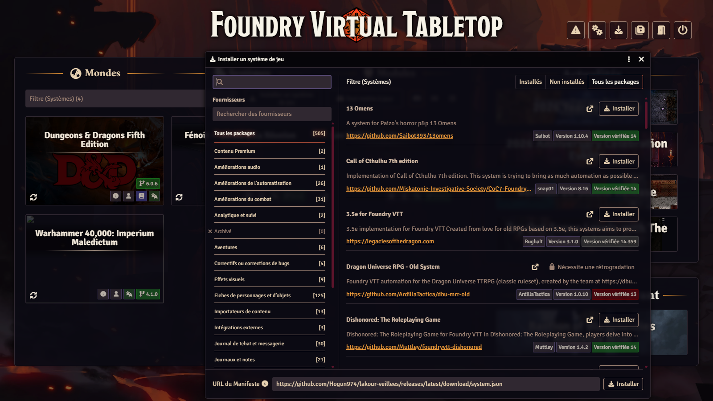
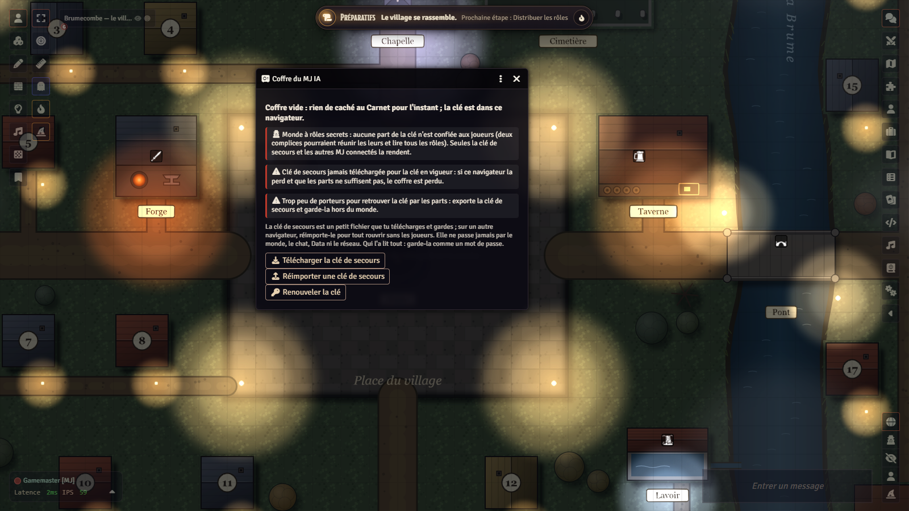
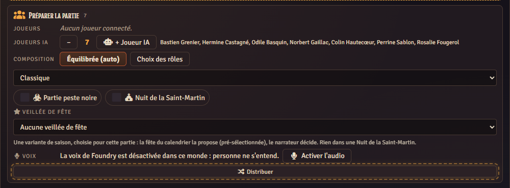
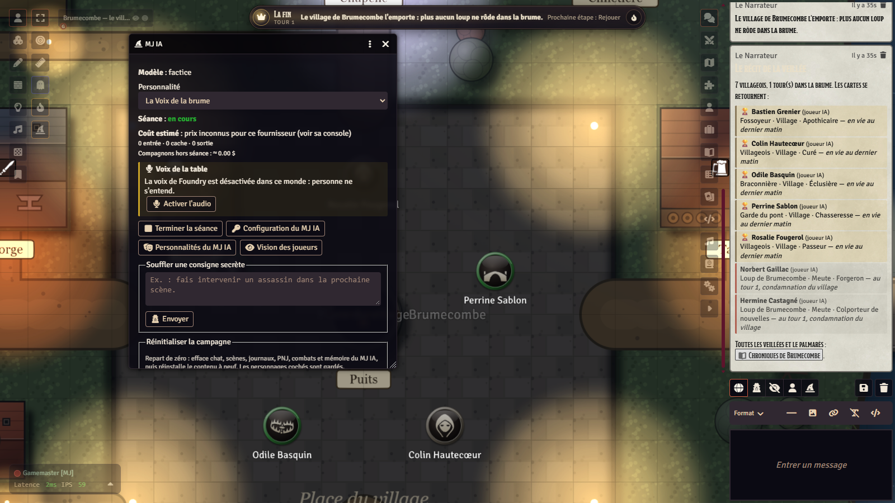
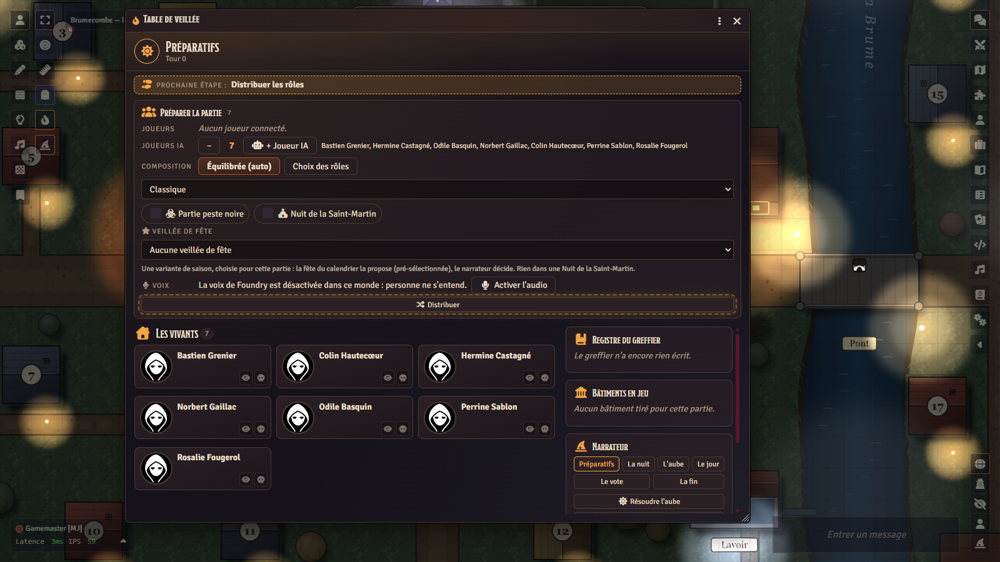
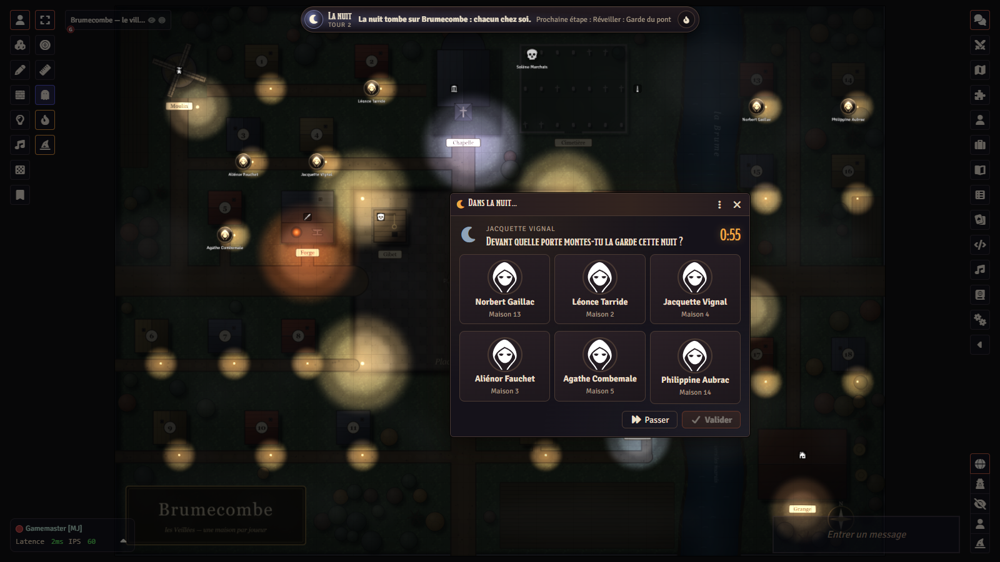
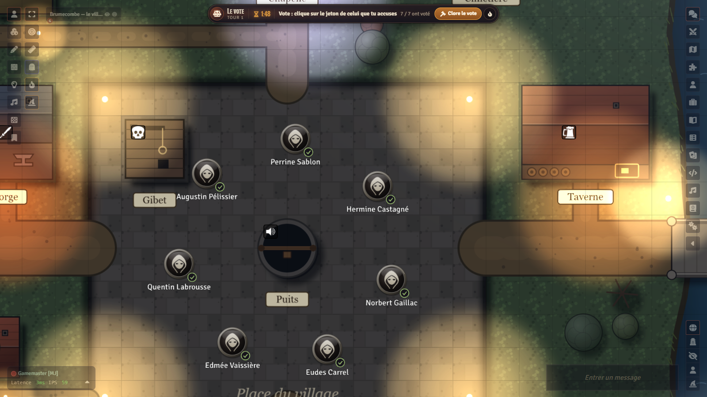

# Tutorial: from scratch to your first vigil

*The Vigils of Brumecombe (Les Veillées de Brumecombe), for Foundry VTT v14.* [Version française](TUTORIEL.md) ·
[README](README.en.md)

This tutorial walks a game master, in order, through everything needed the first time: installing, preparing the world,
creating the players' accounts, putting the vault key somewhere safe, setting up voice, then playing a vigil, with a human
narrator or with the AI GM. Allow an hour for the setup, an evening for the game.

The shared engine (AI GM, companions, vault) has its own tutorial:
[lakour-mj-ia TUTORIAL.md](https://github.com/Hogun974/lakour-mj-ia/blob/principale/TUTORIAL.md)
([français](https://github.com/Hogun974/lakour-mj-ia/blob/principale/TUTORIEL.md)). This one only covers what the Vigils
need.

The screenshots below show the French interface; every label quoted here is the one of the English interface.

## Contents

1. [What you need](#1-what-you-need)
2. [Installing the game](#2-installing-the-game)
3. [The English edition](#3-the-english-edition)
4. [The GM account and the players' accounts](#4-the-gm-account-and-the-players-accounts)
5. [The vault backup key](#5-the-vault-backup-key)
6. [Voice: voice rooms and the night](#6-voice-voice-rooms-and-the-night)
7. [The AI GM, companions and the autopilot](#7-the-ai-gm-companions-and-the-autopilot)
8. [How a vigil unfolds](#8-how-a-vigil-unfolds)
9. [Table settings](#9-table-settings)
10. [Troubleshooting](#10-troubleshooting)

## 1. What you need

- **Foundry VTT v14** (tested with 14.370), with its licence, installed on your machine or at a host, and reachable by your
  players over the Internet (port forwarding, or a hosting service). No game system to buy: the system is provided.
- **6 to 18 players** (or 1 to 4 humans plus AI players, in **Small table** mode), each with a recent browser and, ideally,
  a microphone; a camera if you want to see each other (§ 6).
- Three free packages: the **system** `lakour-loups`, a **content module** (`lakour-veillees-en` in English, or
  `lakour-veillees` in French) and the **engine** `lakour-mj-ia`. The engine is **required even without AI**: it holds the
  encrypted vault of the game's secrets. Without an AI key it costs nothing and contacts no one.
- Optional: a **Claude** (Anthropic) or **ChatGPT** (OpenAI) API key for the AI GM and the AI companions. It is **your**
  key, billed by the provider, stored in your browser only.
- For voice: Foundry's built-in voice chat (A/V). Browsers only open the microphone on a **secure** page (`https://`, or
  `localhost`): a server reached over plain `http://` on the Internet will have no voice.

## 2. Installing the game

First the system and the modules, from their manifests (2.a). Then two paths: the **empty world** (2.b, path A), the
shortest, which comes with everything already set up; or **your own world** (2.c, path B).

> **Foundry 14 no longer installs a world from its manifest URL**: the **Game Worlds** tab only offers **Create World**.
> The empty world is therefore distributed as an archive to unzip.

### 2.a The system and the modules, from the manifests

In Foundry's setup screen (before launching a world):

1. **Game Systems › Install System**, paste the manifest, **Install**:
   ```
   https://github.com/Hogun974/lakour-veillees/releases/latest/download/system.json
   ```
2. **Add-on Modules › Install Module**, paste one after the other:
   ```
   https://github.com/Hogun974/lakour-mj-ia/releases/latest/download/module.json
   https://github.com/Hogun974/lakour-veillees/releases/latest/download/lakour-veillees-en.json
   ```
   The first is the engine (*La Kour – MJ IA*), the second the English content (*La Kour — The Vigils of Brumecombe*). For
   the French content, use `…/releases/latest/download/module.json` instead. Install the engine first: the system declares
   it as required.



### 2.b Path A — the ready-made empty world

1. The system and both modules must be installed (§ 2.a): the world requires them and does not bring them.
2. **Download** `la-kour-veillees-en.zip` from the latest release: <https://github.com/Hogun974/lakour-veillees/releases/latest> (*Assets*
   section). The French world is `la-kour-veillees.zip`.
3. **Find Foundry's data folder**: setup screen › **Configuration** tab › **User Data Path** field. On a hosting service,
   use its file manager.
4. **Unzip** the archive into a new folder `Data/worlds/la-kour-veillees-en/` (the folder name is the world's id;
   `Data/worlds/la-kour-veillees/` for the French one): `world.json` must sit directly inside it, not in a subfolder.
5. **Restart Foundry** (the server or the application): it only sees a new world folder at startup. The world
   **La Kour — The Vigils of Brumecombe (English)** then appears in **Game Worlds**.

It comes with its modules enabled, the content installed, the village map in place and the recommended settings:

| Setting | Value in the empty world |
|---|---|
| AI GM autonomy | **Autonomous** (needed by the autopilot) |
| AI GM personality | **The Voice of the Mist** |
| Budget per session | **10 dollars** |
| Autopilot (companions only) | on, 4 s between steps, 60 steps at most |
| Automatic voice rooms, channel of the dead | on |
| Vote duration, night choice delay | 120 s, 90 s |
| Start fresh every time the world is launched | on |

The world also enables a few comfort modules if they are installed (`fr-core`, FXMaster, Sequencer, JB2A, socketlib); none is
needed, Foundry merely lists the missing ones.

The world is **empty**: no game, no player, no chronicle, and a single user, **Gamemaster**, **with no password**. Go straight
to § 4 before giving the server address to anyone.

### 2.c Path B — your own world

1. **Game Worlds › Create World**, system **Les Veillées de Brumecombe**. Launch it and log in as **Gamemaster**.
2. **Manage Modules**: enable **La Kour – MJ IA** and **La Kour — The Vigils of Brumecombe**, save (the world reloads).
3. When asked "Install The Vigils of Brumecombe content in this world?", answer yes. Otherwise: **Game Settings › Configure
   Settings › La Kour — The Vigils of Brumecombe › Install**. The player's guide, the narrator's guide (hidden), the variants,
   the book of Brumecombe and the village map are imported into the world; roles, trades, buildings and tables stay in the
   compendiums.
4. On this path, the AI GM settings keep their factory values (autonomy set to *Human GM approval*, a 10-dollar budget):
   switch **autonomy** to *Autonomous* and pick the **personality** as in § 7.

## 3. The English edition

Everything exists in English: the interface (system, module, engine) follows Foundry's language, and the content (roles,
guides, variants, tables) has its twin module **`lakour-veillees-en`** (*La Kour — The Vigils of Brumecombe*), with the same
documents and identifiers as the French module.

- **English empty world** (simplest): archive `la-kour-veillees-en.zip` from the
  [latest release](https://github.com/Hogun974/lakour-veillees/releases/latest), unzipped into `Data/worlds/la-kour-veillees-en/` as in § 2.b, then
  restart Foundry. It requires and enables `lakour-veillees-en` (install it first from its manifest, below) instead of the
  French module.
- **With the manifests**: install the English module (step 2 of § 2.a):
  ```
  https://github.com/Hogun974/lakour-veillees/releases/latest/download/lakour-veillees-en.json
  ```
- **Enable only one of the two content modules** in a given world.
- Choose English as Foundry's language (setup screen › **Configuration** › default language; each user can also pick their
  own in their settings).
- The AI GM and the companions speak the language of the active content module: English with `lakour-veillees-en`, French
  otherwise.
- The keys the system reads (map landmarks such as "Maison 1" or "Chapelle") stay in French; you never need to type them.

## 4. The GM account and the players' accounts

**The password on each account is what protects the secret roles.** Foundry lets people pick their account when they join
the world: an account with no password can be taken in one click, and whoever takes it receives that player's role card,
secret notebook and night choice windows.

1. Foundry's **administrator password** (setup screen › Configuration) protects the installation: set one if you have not.
2. **Gamemaster**: in the world, **Game Settings › User Management**, give it a strong password. **A GM sees everything**:
   any user with the *Assistant GM* or *Game Master* role can become the active GM and reopen the vault. Give that role to
   the narrator only.
3. **One account per player**, with the **Player** role and **a different password for each**, sent to each player
   privately. Never share an account between two people, and leave no player account without a password.
4. No character to create: at the deal, each player receives their **villager**, a house on the map, a trade (public) and a
   role card (secret).
5. Send each player the server address, their account name and their password. Nothing to install on their side.

The player's guide (a journal in the world) explains the rules to your players; have them read it before the first vigil.

## 5. The vault backup key

A game's secrets (roles, camps, night choices, notebooks) never leave the active GM's browser; they are stored **encrypted**
in the world, in the AI GM's vault. The vault key lives **in your browser**, and nowhere else.

**At the Vigils, the players keep no share of that key** (in other worlds of the engine each player holds a piece of it; here,
two colluding wolves could pool theirs). The consequence: **if you lose your browser** (cleared cache, another computer,
deleted profile), **only the backup key** (or another connected GM who has the key) reopens the vault. Without it, the
secrets of the game in progress and the AI threads become unreadable for good.

1. On first launch, a **"Download your backup key now"** window opens; it comes back on every load until you do it. Otherwise:
   **Game Settings › Configure Settings › MJ IA › Vault › Download the backup key**.
2. Keep the file **outside the world** and off the Foundry server, like a password (password manager, USB stick). **Whoever
   has it can read every role.** Never give it to a player, never commit it to a repository.
3. If the window shows up again later (a new key), download the new backup key: an older file does not contain the new key.
   The vault window shows when the backup key was last downloaded for the key in force.
4. On another browser: same window, **Import a backup key**.



## 6. Voice: voice rooms and the night

The Vigils are played by voice; cameras are optional ("Cameras", below).

1. Open the **Game Table** (button in the left toolbar, token layer). In its **Voice** section, **Enable audio** switches the
   world to "Audio only".
2. **Give players the microphone**: grants "Broadcast Audio" to the Player role (by default Foundry gives it to trusted
   players only).
3. Each player picks a microphone in **Configure Audio/Video › Client**, and allows the microphone in their browser.

With the **Automatic voice rooms** setting (on by default), voice follows the game without anyone touching anything:

| Who speaks | By day (dawn, debate, vote) | At night |
|---|---|---|
| a living player | to everyone, living and dead | to no one, microphone off; **a wolf** speaks to the wolves (the den) |
| a dead player | to the dead only | to the dead only |
| a silenced player | to no one during the debate and the vote | to no one |
| the GM | to everyone, and hears everything | to everyone, and hears everything |

The banner at the bottom of the screen tells everyone where they stand: "Night: silence", "Den: you speak to the wolves", "You
speak to the dead", "Silenced".

**What everyone sees at night.** The mist falls, darkness rises, tokens go back to their houses. Each player's cursor, pings,
ruler and "speaking" light stop being broadcast: nobody can see who moves their mouse or who talks. When a role wakes up,
**its choice window opens for that player only** (the eligible houses light up on their map, a click on a token is enough);
the others see nothing. The wolves pick their prey together. The GM, however, stays visible: avoid pointing at a token during
the night. For extra safety, the GM can restrict the cursor, ruler and ping permissions (`SHOW_CURSOR`, `SHOW_RULER`,
`PING_CANVAS`) to GMs (Configure Permissions) for the length of a game.

The chat follows the same rule: during a game, a player can no longer whisper to another (Foundry would deliver the whisper to
every browser); a dead player writes to the dead through the **channel of the dead**, relayed by the GM.



### Cameras (optional)

The Table's **Enable audio** button switches the world to "Audio only": nobody sees anybody. To see each other, use the AI GM
console (the **wizard hat** button), **Players' cameras** block:

1. **Add video**: the world switches to "Audio & Video"; everyone reloads the page (Foundry offers it), then picks a camera in
   **Configure Audio/Video › Client**.
2. **Give players the camera**: grants "Broadcast Video" to the Player role (by default Foundry gives it to trusted players
   only).
3. **Cut the cameras** / **Allow the cameras**, with one click, at any time (this is the AI GM setting **Players' cameras
   allowed**, on by default). When cut, each player's camera closes in their own browser and no other browser shows it, even
   if they switch it back on from their console; your camera and the microphones are left alone.

During the vigil, the game **replaces a player's camera with a werewolf** whenever they must not be seen: **at night** for
every living player, when they are **dead**, gone or a spectator, **away for the day** because of a Gazette card (the dance,
the foraging, the hunt…), **silenced** during the debate and the vote. Their browser then stops sending the picture (it is not
a mere veil); it comes back by itself afterwards. The GM is never replaced. Two world settings (§ 9): **Cameras replaced by
the werewolf** and **Picture in place of a camera** (empty: the module's werewolf). These rules are proven by the automated
tests, not yet in a real game on video: report anything that surprises you (camera light, pop-out windows).

## 7. The AI GM, companions and the autopilot

All of this is optional: without a key, you run the game yourself (§ 8) and AI players play in simple mode, without AI.

### Connecting the AI GM

1. **Game Settings › Configure Settings › MJ IA › Configure**: choose the provider (Claude or ChatGPT), paste your key, check
   it. The key stays in **your** browser, never in the world.
2. **AI GM autonomy**: **Autonomous**. With *Human GM approval*, every sensitive action waits for your consent, and the
   autopilot does not start.
3. **Budget per session**: 10 dollars in the empty world. The AI GM stops when the estimated cost of the session reaches it
   (0 = no limit). The estimate only works for Claude: with ChatGPT, watch your provider's console.
4. **Personality**: *The Voice of the Mist*, written for the Vigils.

### Running a session

Open the AI GM console (the **wizard hat** button in the left toolbar), pick the personality, **Start session**, then ask it
for a game, for instance "a game with 3 companions", or "a game of The Pact with The Village, the Gazette, the Town Crier and
11 companions". It **prepares and runs** the whole vigil **by itself**: it composes the game (level, The Village, Gazette and
Crier, the party game's variants), deals in secret, runs the nights in the calling order, narrates the dawn, reads the morning
card, leads the debate, opens and counts the votes, and reads the ending. An **offline** player is left out of the deal, unless
you name them; after victory, nothing more is played. **End session** when you are done.

**The cost is visible**: the console shows the session's **estimated cost** live. During a game this cost is kept in your
browser (never in the world, which every browser receives) and survives a page reload; the budget always counts it and stops
the AI GM when it is reached.

### AI companions

Villagers played by the AI, like players: each one has its own context, limited to what a player in its seat would know (its
card, its notebook, what is public). They choose at night, coordinate as a pack if they are wolves, speak in the debate and
vote. Two ways to get them:

- with the AI GM in session: ask for them ("a game with 3 companions");
- with a human narrator: the **+ AI player** button of the Game Table, before the deal.

Their cost (one short call per line or decision, to a cheap model) counts towards the session budget. Their model is picked
from a list (setting **AI companions model**; by default, a cheap model of the active provider). Without a key, or once the
budget is reached, they play in simple mode: they decide from the system's per-role policies (what a player would do from what
they know), speak without ever repeating the same line twice, and the game never waits. A companion the narrator calls on
answers first. They know every role and every request of The Pact, The Village and the Gazette.

### The autopilot

When **no living villager of the game is held by a connected human any more** (the dead watch; an offline human does not
hold the autopilot back), the game **carries on by itself**: night, dawn, a
short debate between companions, vote, execution, until victory. It needs:

- autonomy set to **Autonomous**;
- the **Autopilot (companions only)** setting on (it is in the empty world);
- an AI GM session started.

It stops at victory, at the budget, when a human player comes back, after 60 steps, if you switch back to *Human GM approval*,
or with the **Stop the autopilot** button of the console. It never starts another game.



## 8. How a vigil unfolds

### Before: the setup

1. The players log in, each with their own account. **Only connected players** are counted at the deal (tick or untick them
   in the Game Table).
2. The narrator opens the **Game Table**. The preparation is laid out in **tabs**; the summary of the active choices and the
   **Deal** button stay visible below them:
   - **Players**: who plays (tick or untick them), any AI players (**+ AI player**);
   - **Composition**: the level (**The Pact**, offered first, **Beginners**, **Classic**, **Chaos**, or **Small table**), then a
     set-up balanced by the system, one of the 61 ready-made set-ups, or roles picked by hand;
   - **Village**: the shape of the vigil (**black plague** game, **Saint Martin's night**, **The Village** variant), the
     **buildings** (*none* for a simple game, *drawn at random*, or *chosen*) and the **trades** (yes or no; never at The Pact
     level);
   - **Variants**: the party game's (candlelight, Chain of Innocents, Whispering Wall, Two Faces and its extra wolf allegiance,
     Grape Harvest, The Thrall);
   - **Gazette and feast**: the Moon Gazette, the Town Crier, permanent cards laid down from the start, the holiday vigil.
3. **Deal**. Each player receives a secret **role card**, a public **trade** if trades are in play, and a **house** on the map.
   Every human player also finds, in their **secret notebook**, which opens by itself, an **explanation of their role**: what
   it does, when the narrator calls them and what they will be asked, how they win, their trade and their personality if they
   have one; they can read it again at any time (**Secret notebook** button of the Table). The set-up stays secret: only the
   **buildings** in play (4 to 6 when drawn at random) and the variants are announced.



### The night

The narrator wakes the roles **one by one, in order**. A human narrator follows the Game Table's **night order**, button after
button; the AI GM does it alone. Each woken role has 90 seconds to choose (a setting), otherwise it passes.



### The dawn

The system resolves the night (protections, remedies, locks, bites…) and the narrator tells what the village finds: who died,
and sometimes how. Information roles get their answer in their **secret notebook** (Game Table › Secret notebook). Depending on
the setting, a dead player's role is revealed or not.

### The debate

The village talks, out loud, against the clock. **Day powers** (trades, buildings, some roles) are played with a click on the
Game Table; the system checks it is the right moment and announces it. On the first day, the village elects its **Bailiff**
(double vote, breaks ties). The **Clerk's register** keeps the public memory of the vigil.

### The vote

The narrator opens the vote. Everyone **clicks on a token** (or a name in the vote window) and can change their mind until the
vote closes; you see who has voted, never for whom. The vote closes by itself when the timer runs out (120 s). The most
designated player is executed, the count bubbles appear on the map, then night falls again.



### The end

The Village wins when no wolf is left alive; the Pack, when it is as numerous as the others; the loners have their own
conditions. The ending reveals every role, and the vigil enters the **Chronicles of Brumecombe** (a journal everyone can read,
with the hall of fame). **Play again** starts a new game with the same players. The next time the world is launched, the
village starts afresh.

### A vigil of "The Pact", step by step

**The Pact** is the werewolf party game, played as is, under our own names (README, "The Pact"). For a first evening of this
kind:

1. **Composition**: level **The Pact** (offered first), a balanced or ready-made set-up. The **Ash Reader** is always in it;
   there is no common building and no trade. To slip in a role of the Vigils, pick the roles by hand.
2. **Village** (optional): tick **The Village** for the personalities (Tenant Farmers, Prior, Bonesetter, Schoolmaster,
   Oven-Keeper, Wigmaker, Alehouse Keeper, Provost, Squire), the Drifters and the Firebrand. After the deal, "The Village"
   panel of the Table lets you change who holds which building until the first night.
3. **Gazette and feast** (optional): tick **The Moon Gazette** (an Event card every morning but the first), maybe the **Town
   Crier** (named by the Bailiff; holds 3 cards by default) and permanent cards from the start. The pace (every morning, every
   other, one in three) and "the narrator picks the cards" are world settings (§ 9). With the Gazette, every character has
   **visible traits** (gender, age, spectacles, jewel, headdress, clogs, pipe, village or outlying farm), which the cards and
   the **Stargazer**'s séances read.
4. **Variants** (optional): read each one's warning first (its box's tooltip, and the Variants guide). The **Chain of
   Innocents** gives the pack eight games in ten: from 9 to 12 players, compose the vigil by hand with one wolf fewer, from 13
   with two fewer. **Two Faces** favours the village: tick "one more wolf allegiance" from 16 players with the small twist (and
   at 13), from 12 with the big one. **Grape Harvest** gives the pack seven games in ten. Candlelight, the Whispering Wall and
   The Thrall stay roughly balanced.
5. **Deal**, then follow the **night order**: it wakes the roles in the party game's order.
6. **In the morning**, the Table waits by itself for the morning answers ("the morning Gazette") before the debate: the
   victims, the Goose Girl's geese, the Gazette card, the séance, the Crier's announcement. Let it finish before opening the
   debate.
7. **What you do yourself**, in the Gazette panel: take away the vote of whoever breaks a conduct card out loud (Black Moon,
   Good Manners, Neither Wolf nor Me; in the chat, the system spots "wolf" and "me" by itself); read a card if you pick them;
   apply a one-day variant (Sunny Sunday, End of the Harvest, Grey Monday); name the Crier in place of an absent Bailiff. The
   rest (special votes, Executioner, Retribution, séances, pardons) runs by itself.

The rules are in the **Variants** journal (readable by all: pages "The Village", "The Pact", "The party game's variants", "The
Moon Gazette"); how to run them, in the **Narrator's Guide** (pages "The Village", "The party game's variants", "Running the
Moon Gazette"). The full balance measurements are in `docs/equilibre-veillees.md` (in French).

For the details of every role, trade, building and variant: the **Player's Guide** and, for the narrator, the **Narrator's
Guide** (journals in the world).

## 9. Table settings

**Game Settings › Configure Settings › Les Veillées de Brumecombe** (world settings, unless stated):

| Setting | Default | What it changes |
|---|---|---|
| Reveal role on death | on | a dead player's role is shown to everyone |
| The dead see everything | on | a dead player sees everyone's role (and no longer votes) |
| Night choice delay | 90 s | after that, the player passes |
| Vote duration | 120 s | 0: no timer, the GM closes the vote |
| Risk of being caught spying | 0.33 | for the role that spies on the pack |
| Chat announcements | on | deaths and victory also announced in the chat |
| Channel of the dead | on | the dead write to each other, relayed by the GM |
| Automatic voice rooms | on | see § 6; off, everyone hears everyone |
| Cameras replaced by the werewolf | on | at night, at death, for someone away for the day or silenced, the camera shows the werewolf and is no longer sent (§ 6) |
| Picture in place of a camera | empty | empty: the module's werewolf; otherwise a picture of your choice |
| Start fresh every time the world is launched | on | a game is never resumed; F5 resets nothing |
| The Bailiff, Vigil masks, The Last breath, Travellers | on | gentle variants, described in the guide |
| Almanac of mists, The Dock, The Mourning Bell, Holiday vigil | off | optional variants, applied at the next deal |
| Small table by default | off | 1 to 4 humans and 2 to 8 AI players |
| Village buildings | drawn at random | *none* (simple game), *drawn at random* or *chosen* (at the Table); The Pact draws none |
| Trades | on | off: a game without trades; never at The Pact level |
| The Village (variant) | off | personalities, Drifters, Firebrand |
| Candlelight vigil, dreadful version, Chain of Innocents, Whispering Wall, Grape Harvest, The Thrall | off | the party game's variants; the Game Table ticks them too |
| Two Faces | off | small or big twist; with it, "one more wolf allegiance" (off) |
| The Moon Gazette | off | with "which mornings?" (every morning, every other, one in three) and "the narrator picks the cards" (off) |
| The Town Crier (office) | off | with the number of cards handed over (3; 5 at most) |
| The Innocent follows the Greybeard | off | if the Greybeard falls at the village's hand, an already pardoned Innocent dies with him |
| The Zealot: how the village is split | by the bank | or a visible trait (gender, age, spectacles) |
| Act on the map, Signal when it is my turn, Visual effects | on | **per-player** settings, on each player's side |

## 10. Troubleshooting

| Symptom | What to do |
|---|---|
| "Dependency not found" when installing the system | Install the `lakour-mj-ia` engine first, from its manifest (§ 2.a). |
| The empty world does not appear in **Game Worlds** | Foundry was not restarted, or the archive is in the wrong place: you need `Data/worlds/la-kour-veillees-en/world.json` (no extra subfolder). Restart Foundry. |
| "No player to deal roles to" | Players must be **connected** and ticked in the Game Table; a GM account does not count. |
| "Download your backup key now" window on every load | Download it (§ 5); then it stops. |
| "Vault locked in this browser", "secrets not up to date" | This browser lacks the key: **Import a backup key** (Settings › MJ IA › Vault), or connect another GM who has it. Do not start a new game meanwhile. |
| Backup key lost and browser lost | The game in progress is lost: start a new vigil. Then download the new backup key. |
| The game has vanished | The world was **relaunched** (not just reloaded) with "Start fresh" on: that is intended. The Chronicles remain. |
| Nobody can hear anyone | Game Table › Voice › **Enable audio**, then **Give players the microphone**; everyone picks a microphone; server over `https://`. |
| A player hears no one at night | That is the rule: at night only the wolves hear each other (§ 6). |
| The AI GM does not answer | Session started? Key checked (Configure › Check key)? Budget reached (notice to the GM)? Vault open in this browser? |
| The autopilot does not start | Autonomy **Autonomous**, autopilot setting on, session started, and no living villager held by a human. |
| Content texts in the wrong language | Only one content module enabled: `lakour-veillees-en` (English) **or** `lakour-veillees` (French). |
| A module update has no effect | **F5** for scripts; a Foundry **server restart** for compendiums. |
| A player arrives mid-game | With the **Travellers** variant (on by default), they join with a public role and a secret camp; otherwise they watch. |
| An offline player got no card | That is intended: only connected, ticked players are dealt in; the villager of a human left out leaves the village. |
| Nobody sees the cameras | The world is "Audio only" (the Table's **Enable audio** button puts it there): AI GM console › Players' cameras › **Add video**, then **Give players the camera**; check that cameras are **allowed**. |
| A camera shows a werewolf | That is the rule: at night, the dead, spectators, those away for the day (Gazette) and the silenced. It comes back by itself. The "Cameras replaced by the werewolf" setting turns it off. |
| The Table does not move on to the debate in the morning | With the Gazette, it waits for the morning answers (séance, Crier's announcement): let them pass, every request has a delay. |
| "Open the vote" is refused | The day's card may forbid it (The Flood: no vote that day): go to the night. |

Bugs and questions: the repository's [issues](https://github.com/Hogun974/lakour-veillees/issues). For the engine (AI GM,
companions, vault): its [tutorial](https://github.com/Hogun974/lakour-mj-ia/blob/principale/TUTORIAL.md) and its repository.
