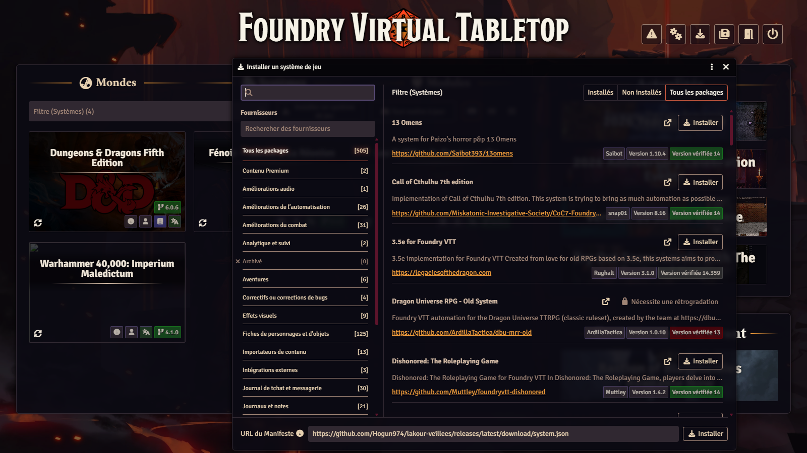
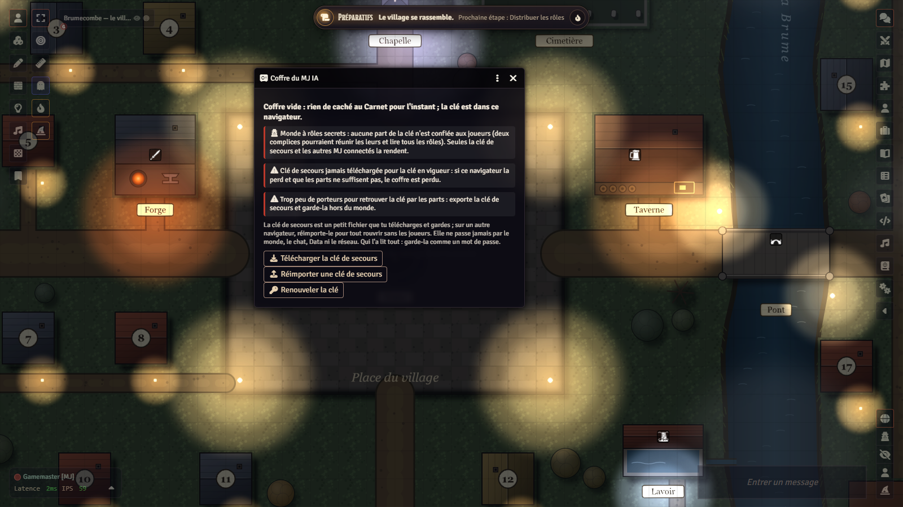
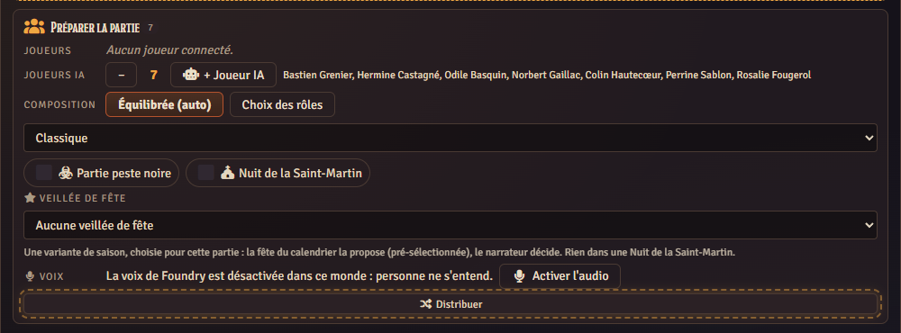
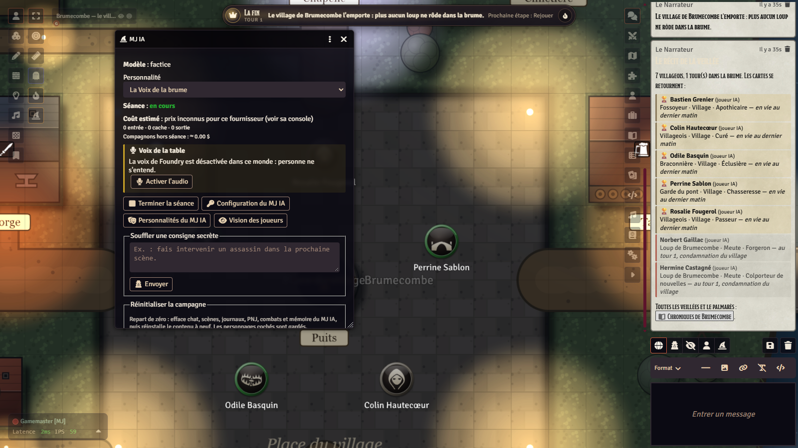
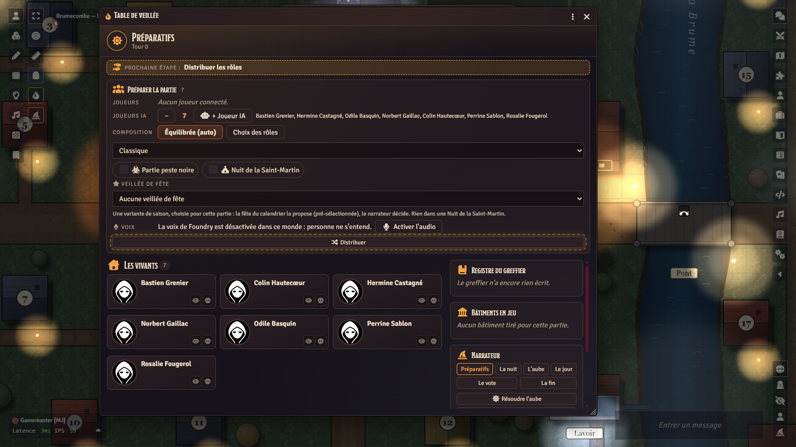
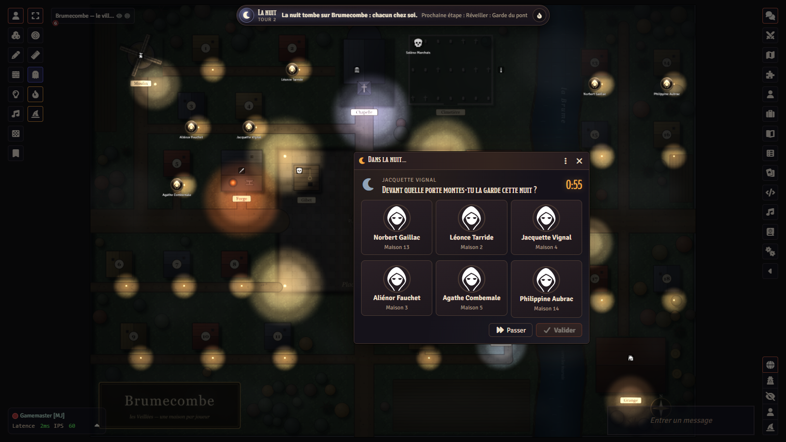
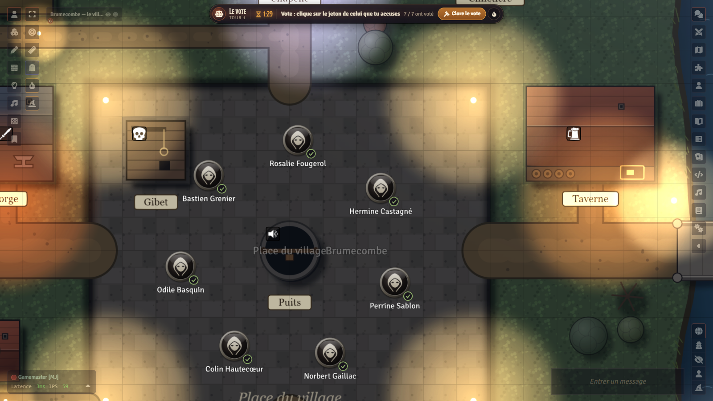

# Tutoriel : de zéro à la première veillée

*Les Veillées de Brumecombe, pour Foundry VTT v14.* [English version](TUTORIAL.md) · [README](README.md)

Ce tutoriel suit, dans l'ordre, tout ce qu'un meneur de jeu fait la première fois : installer, préparer le monde, créer les
comptes des joueurs, mettre la clé du coffre en lieu sûr, régler la voix, puis jouer une veillée, avec un narrateur humain
ou avec le MJ IA. Comptez une heure pour la mise en place, une soirée pour la partie.

Le moteur commun (MJ IA, compagnons, coffre) a son propre tutoriel :
[TUTORIEL.md de lakour-mj-ia](https://github.com/Hogun974/lakour-mj-ia/blob/principale/TUTORIEL.md)
([English](https://github.com/Hogun974/lakour-mj-ia/blob/principale/TUTORIAL.md)). Celui-ci ne reprend que ce qui sert aux
Veillées.

## Sommaire

1. [Ce qu'il faut](#1-ce-quil-faut)
2. [Installer le jeu](#2-installer-le-jeu)
3. [La version anglaise](#3-la-version-anglaise)
4. [Le compte du MJ et ceux des joueurs](#4-le-compte-du-mj-et-ceux-des-joueurs)
5. [La clé de secours du coffre](#5-la-clé-de-secours-du-coffre)
6. [La voix : salons vocaux et nuit](#6-la-voix--salons-vocaux-et-nuit)
7. [Le MJ IA, les compagnons et le pilote automatique](#7-le-mj-ia-les-compagnons-et-le-pilote-automatique)
8. [Le déroulé d'une veillée](#8-le-déroulé-dune-veillée)
9. [Les réglages de table](#9-les-réglages-de-table)
10. [Dépannage](#10-dépannage)

## 1. Ce qu'il faut

- **Foundry VTT v14** (testé avec la 14.370), avec sa licence, installé chez vous ou chez un hébergeur, et joignable par vos
  joueurs depuis Internet (redirection de port, ou hébergeur). Aucun système de jeu à acheter : le système est fourni.
- **6 à 18 joueurs** (ou 1 à 4 humains complétés par des joueurs IA, en **Petite tablée**), chacun avec un navigateur récent
  et, de préférence, un micro.
- Trois paquets gratuits : le **système** `lakour-loups`, le **module de contenu** `lakour-veillees` (ou sa version anglaise
  `lakour-veillees-en`) et le **moteur** `lakour-mj-ia`. Le moteur est **requis même sans IA** : il tient le coffre chiffré
  des secrets de la partie. Sans clé d'IA, il ne coûte rien et ne contacte personne.
- Facultatif : une clé d'API **Claude** (Anthropic) ou **ChatGPT** (OpenAI) pour le MJ IA et les compagnons IA. C'est
  **votre** clé, facturée par le fournisseur, rangée dans votre seul navigateur.
- Pour la voix : la voix intégrée de Foundry (A/V). Les navigateurs n'ouvrent le micro que sur une page **sécurisée**
  (`https://`, ou `localhost`) : un serveur en `http://` sur Internet n'aura pas de voix.

## 2. Installer le jeu

D'abord le système et les modules, par leurs manifestes (2.a). Ensuite, deux chemins : le **monde vierge** (2.b, chemin A),
le plus court, qui arrive avec tout déjà réglé ; ou **votre propre monde** (2.c, chemin B).

> **Foundry 14 n'installe plus de monde par son URL de manifeste** : l'onglet **Mondes de jeu** ne propose que **Créer un
> monde**. Le monde vierge se distribue donc en archive à décompresser.

### 2.a Le système et les modules, par les manifestes

Dans l'écran de configuration de Foundry (avant de lancer un monde) :

1. **Systèmes de jeu › Installer un système**, coller le manifeste, **Installer** :
   ```
   https://github.com/Hogun974/lakour-veillees/releases/latest/download/system.json
   ```
2. **Modules › Installer un module**, coller l'un après l'autre :
   ```
   https://github.com/Hogun974/lakour-mj-ia/releases/latest/download/module.json
   https://github.com/Hogun974/lakour-veillees/releases/latest/download/module.json
   ```
   Le premier est le moteur (*La Kour – MJ IA*), le second le contenu français (*La Kour — Les Veillées de Brumecombe*).
   Installez le moteur d'abord : le système le déclare requis.



### 2.b Chemin A — le monde vierge, tout prêt

1. Le système et les deux modules doivent être installés (§ 2.a) : le monde les exige et ne les apporte pas.
2. **Téléchargez** `la-kour-veillees.zip` dans la dernière version publiée : <https://github.com/Hogun974/lakour-veillees/releases/latest> (rubrique
   *Assets*).
3. **Trouvez le dossier de données de Foundry** : écran de configuration › onglet **Configuration** › champ **Chemin des
   données** (*User Data Path*). Sur un hébergeur, passez par son gestionnaire de fichiers.
4. **Décompressez** l'archive dans un nouveau dossier `Data/worlds/la-kour-veillees/` (le nom du dossier est l'identifiant du
   monde) : `world.json` doit se trouver directement dedans, pas dans un sous-dossier.
5. **Redémarrez Foundry** (le serveur ou l'application) : il ne voit un nouveau dossier de monde qu'au démarrage. Le monde
   **La Kour — Les Veillées de Brumecombe** apparaît alors dans **Mondes de jeu**.

Il arrive avec les modules actifs, le contenu installé, la carte du village en place et les réglages conseillés :

| Réglage | Valeur du monde vierge |
|---|---|
| Autonomie du MJ IA | **Autonome** (nécessaire au pilote automatique) |
| Personnalité du MJ IA | **La Voix de la brume** |
| Budget par séance | **10 dollars** |
| Pilote automatique (compagnons seuls) | coché, 4 s entre deux étapes, 60 étapes au plus |
| Salons vocaux automatiques, canal des morts | cochés |
| Durée du vote, délai des choix de nuit | 120 s, 90 s |
| Repartir de zéro à chaque lancement du monde | coché |

Le monde active aussi quelques modules de confort s'ils sont installés (`fr-core` pour l'interface de Foundry en français,
FXMaster, Sequencer, JB2A, socketlib) ; aucun n'est nécessaire, Foundry signale seulement ceux qui manquent.

Le monde est **vierge** : aucune partie, aucun joueur, aucune chronique, et un seul utilisateur, **Gamemaster**, **sans mot de
passe**. Passez tout de suite au § 4 avant d'envoyer l'adresse du serveur à qui que ce soit.

### 2.c Chemin B — votre propre monde

1. **Mondes de jeu › Créer un monde**, système **Les Veillées de Brumecombe**. Lancez-le, connectez-vous en **Gamemaster**.
2. **Gérer les modules** : activez **La Kour – MJ IA** et **La Kour — Les Veillées de Brumecombe**, enregistrez (le monde se
   recharge).
3. À la question « Installer le contenu des Veillées de Brumecombe dans ce monde ? », répondez oui. Sinon : **Réglages du jeu ›
   Configurer les réglages › La Kour — Les Veillées de Brumecombe › Installer**. Le guide du joueur, le guide du narrateur
   (caché), les variantes, le livre de Brumecombe et la carte du village arrivent dans le monde ; rôles, métiers, bâtiments et
   tables restent dans les compendiums.
4. Dans ce chemin, les réglages du MJ IA gardent leurs valeurs d'usine (autonomie en *Validation*, budget de 10 dollars) :
   passez l'**autonomie** en *Autonome* et choisissez la **personnalité** comme au § 7.

## 3. La version anglaise

Tout existe en anglais : l'interface (système, module, moteur) suit la langue de Foundry, et le contenu (rôles, guides,
variantes, tables) a son module jumeau **`lakour-veillees-en`** (*La Kour — The Vigils of Brumecombe*), mêmes documents et
mêmes identifiants que le module français.

- **Monde vierge anglais** (le plus simple) : archive `la-kour-veillees-en.zip` de la
  [dernière version](https://github.com/Hogun974/lakour-veillees/releases/latest), à décompresser dans `Data/worlds/la-kour-veillees-en/` comme au
  § 2.b, puis redémarrer Foundry. Il exige et active `lakour-veillees-en` (à installer d'abord par son manifeste, ci-dessous)
  au lieu du module français.
- **Par les manifestes** : installez le module anglais à la place du français (étape 2 du § 2.a) :
  ```
  https://github.com/Hogun974/lakour-veillees/releases/latest/download/lakour-veillees-en.json
  ```
- **N'activez qu'un des deux modules de contenu** dans un même monde.
- Choisissez l'anglais comme langue de Foundry (écran de configuration › **Configuration** › langue par défaut ; chacun peut
  aussi choisir la sienne dans ses réglages).
- Le MJ IA et les compagnons parlent la langue du module de contenu actif : anglais avec `lakour-veillees-en`, français
  sinon.

## 4. Le compte du MJ et ceux des joueurs

**C'est le mot de passe de chaque compte qui protège les rôles secrets.** Foundry laisse choisir son compte à l'entrée du
monde : un compte sans mot de passe se prend en un clic, et qui le prend reçoit la carte de rôle, le carnet secret et les
fenêtres de choix de nuit de ce joueur.

1. **Le mot de passe d'administration** de Foundry (écran de configuration › Configuration) protège l'installation : posez-en
   un si ce n'est pas déjà fait.
2. **Gamemaster** : dans le monde, **Réglages du jeu › Gérer les utilisateurs**, donnez-lui un mot de passe solide. **Un MJ
   voit tout** : tout utilisateur au rôle *Assistant MJ* ou *Maître du jeu* peut devenir le meneur et rouvrir le coffre. Ne
   donnez ce rôle qu'au narrateur.
3. **Un compte par joueur**, au rôle **Joueur**, avec **un mot de passe différent pour chacun**, transmis à chacun en privé.
   Ne partagez jamais un compte entre deux personnes, et ne laissez aucun compte joueur sans mot de passe.
4. Aucun personnage à créer : à la distribution, chaque joueur reçoit son **villageois**, sa maison sur la carte, son métier
   (public) et sa carte de rôle (secrète).
5. Envoyez à chaque joueur l'adresse du serveur, son nom de compte et son mot de passe. Rien à installer de son côté.

Le guide du joueur (journal du monde) explique les règles à vos joueurs ; faites-le-leur lire avant la première veillée.

## 5. La clé de secours du coffre

Les secrets d'une partie (rôles, camps, choix de nuit, carnets) ne quittent pas le navigateur du meneur ; ils sont rangés
**chiffrés** dans le monde, dans le coffre du MJ IA. La clé du coffre est **dans votre navigateur**, et nulle part ailleurs.

**Aux Veillées, les joueurs ne gardent aucune part de cette clé** (dans d'autres mondes du moteur, chaque joueur en garde un
morceau ; ici, deux loups complices pourraient réunir les leurs). Conséquence : **si vous perdez votre navigateur** (cache
vidé, autre ordinateur, profil effacé), **seule la clé de secours** (ou un autre MJ connecté qui a la clé) rouvre le coffre.
Sans elle, les secrets de la partie en cours et les fils de l'IA deviennent illisibles pour de bon.

1. Au premier lancement, une fenêtre **« Télécharge ta clé de secours maintenant »** s'ouvre ; elle revient à chaque
   chargement tant que ce n'est pas fait. Sinon : **Réglages du jeu › Configurer les réglages › MJ IA › Coffre ›
   Télécharger la clé de secours**.
2. Gardez le fichier **hors du monde** et hors du serveur de Foundry, comme un mot de passe (gestionnaire de mots de passe,
   clé USB). **Qui l'a lit tous les rôles.** Ne le donnez à aucun joueur, ne le versez dans aucun dépôt.
3. Si la fenêtre réapparaît plus tard (nouvelle clé), téléchargez la nouvelle clé de secours : un ancien fichier ne contient
   pas la nouvelle clé. La fenêtre du Coffre indique la date du dernier téléchargement pour la clé en vigueur.
4. Sur un autre navigateur : même fenêtre, **Réimporter une clé de secours**.



## 6. La voix : salons vocaux et nuit

Les Veillées se jouent à la voix, en **audio seulement** (pas de vidéo).

1. Ouvrez la **Table de jeu** (bouton dans la barre de gauche, calque des jetons). Section **Voix** : **Activer l'audio** passe
   le monde en « Audio seulement ».
2. **Donner le micro aux joueurs** : accorde « Diffuser l'audio » au rôle Joueur (par défaut, Foundry ne le donne qu'aux
   joueurs de confiance).
3. Chaque joueur choisit son micro dans **Configurer l'audio et la vidéo › Client**, et autorise le micro dans son navigateur.

Avec le réglage **Salons vocaux automatiques** (coché par défaut), la voix suit la partie, sans rien toucher :

| Qui parle | Le jour (aube, débat, vote) | La nuit |
|---|---|---|
| un vivant | à tous, vivants et morts | à personne, micro coupé ; **un loup** parle aux loups (la tanière) |
| un mort | aux morts seulement | aux morts seulement |
| un joueur réduit au silence | à personne pendant le débat et le vote | à personne |
| le MJ | à tous, et il entend tout | à tous, et il entend tout |

Le bandeau en bas de l'écran dit à chacun où il en est : « La nuit, silence », « Tanière : tu parles aux loups », « Tu parles
aux morts », « Réduit au silence ».

**Ce que voit chacun, la nuit.** La brume tombe, l'obscurité monte, les jetons rentrent devant leur maison. Le curseur, les
pings, la règle et le voyant « parle » de chaque joueur cessent d'être diffusés : personne ne voit qui bouge sa souris ni qui
parle. Quand un rôle se réveille, **sa fenêtre de choix ne s'ouvre que chez lui** (les maisons possibles s'allument sur sa
carte, un clic sur un jeton suffit) ; les autres ne voient rien. Les loups choisissent ensemble leur proie. Le MJ, lui, reste
visible : qu'il évite de pointer un jeton pendant la nuit. Pour plus de sûreté, il peut réserver aux MJ les droits du curseur,
de la règle et des pings (`SHOW_CURSOR`, `SHOW_RULER`, `PING_CANVAS`, dans Configuration › Droits des utilisateurs) le temps d'une partie.

Le chat aussi suit la règle : pendant une partie, un joueur ne chuchote plus à un autre (Foundry livrerait le chuchotement à
tous les navigateurs) ; un mort écrit aux morts par le **canal des morts**, relayé par le MJ.



## 7. Le MJ IA, les compagnons et le pilote automatique

Tout cela est facultatif : sans clé, vous menez la partie vous-même (§ 8) et les joueurs IA jouent en mode simple, sans IA.

### Brancher le MJ IA

1. **Réglages du jeu › Configurer les réglages › MJ IA › Configurer** : choisissez le fournisseur (Claude ou ChatGPT), collez
   votre clé, vérifiez-la. La clé reste dans **votre** navigateur, jamais dans le monde.
2. **Autonomie du MJ IA** : **Autonome**. En *Validation par le MJ humain*, chaque action sensible attend votre accord, et le
   pilote automatique ne part pas.
3. **Budget par séance** : 10 dollars dans le monde vierge. Le MJ IA s'arrête quand l'estimation du coût de la séance
   l'atteint (0 = sans limite). L'estimation ne vaut que pour Claude : avec ChatGPT, surveillez la console de votre
   fournisseur.
4. **Personnalité** : *La Voix de la brume*, écrite pour les Veillées.

### Mener une séance

Ouvrez la console du MJ IA (bouton **chapeau de magicien**, barre de gauche), choisissez la personnalité, **Démarrer la
séance**, puis demandez-lui une partie, par exemple « une partie avec 3 compagnons ». Il compose, distribue en secret, mène les
nuits, raconte l'aube, anime le débat, ouvre et dépouille les votes, lit le récit de fin. **Terminer la séance** à la fin.

### Les compagnons IA

Des villageois tenus par l'IA, comme des joueurs : chacun a son propre contexte, limité à ce que saurait un joueur à sa place
(sa carte, son carnet, ce qui est public). Ils choisissent la nuit, se coordonnent en meute s'ils sont loups, parlent au débat
et votent. Deux façons d'en avoir :

- avec le MJ IA en séance : demandez-les-lui (« une partie avec 3 compagnons ») ;
- avec un narrateur humain : bouton **+ Joueur IA** de la Table de jeu, avant la distribution.

Leur coût (un appel court par réplique ou décision, à un modèle bon marché) compte dans le budget de la séance. Sans clé ou
budget atteint, ils jouent en mode simple et la partie n'attend jamais.

### Le pilote automatique

Quand **plus aucun vivant n'est tenu par un humain** (les morts regardent), la partie **continue seule** : nuit, aube, un court
débat entre compagnons, vote, exécution, jusqu'à la victoire. Il faut :

- l'autonomie en **Autonome** ;
- le réglage **Pilote automatique (compagnons seuls)** coché (c'est le cas dans le monde vierge) ;
- une séance du MJ IA démarrée.

Il s'arrête à la victoire, au budget, au retour d'un joueur humain, après 60 étapes, si vous repassez en *Validation*, ou par
le bouton **Arrêter le pilote** de la console. Il ne relance jamais une autre partie.



## 8. Le déroulé d'une veillée

### Avant : les préparatifs

1. Les joueurs se connectent, chacun avec son compte. **Seuls les joueurs connectés** sont comptés à la distribution (cochez
   ou décochez-les dans la Table de jeu).
2. Le narrateur ouvre la **Table de jeu** : nombre de joueurs, niveau (**Débutants**, **Classique**, **Chaos**, ou **Petite
   tablée**), variantes, joueurs IA éventuels. Laissez le système composer, ou prenez une des 48 compositions prêtes.
3. **Distribuer**. Chacun reçoit en secret sa **carte de rôle**, publiquement un **métier**, et sa **maison** sur la carte. La
   composition reste secrète : seuls les 4 à 6 **bâtiments** en jeu sont annoncés, chacun change une règle.



### La nuit

Le narrateur réveille les rôles **un par un, dans l'ordre**. Un narrateur humain suit l'**Ordre de nuit** de la Table, bouton
après bouton ; le MJ IA le fait seul. Chaque rôle réveillé a 90 secondes pour choisir (réglage), sinon il passe.



### L'aube

Le système résout la nuit (protections, remèdes, verrous, morsure…) et le narrateur raconte ce que le village découvre :
qui est mort, et parfois comment. Les rôles d'information reçoivent leur réponse dans leur **carnet secret** (Table de jeu ›
Carnet secret). Selon le réglage, le rôle d'un mort est révélé ou non.

### Le débat

Le village discute, à voix haute, au minuteur. Les **pouvoirs de jour** (métiers, bâtiments, certains rôles) se jouent d'un
clic sur la Table de jeu ; le système vérifie que c'est le bon moment et l'annonce. Le premier jour, le village élit son
**Bailli** (voix double, il tranche les égalités). Le **Registre du greffier** garde la mémoire publique de la veillée.

### Le vote

Le narrateur ouvre le vote. Chacun **clique sur un jeton** (ou un nom dans la fenêtre de vote) et peut changer d'avis jusqu'à
la clôture ; on voit qui a voté, jamais pour qui. Le vote se clôt seul à la fin du minuteur (120 s). Le plus désigné est
exécuté, les bulles du dépouillement s'affichent sur la carte, puis la nuit revient.



### La fin

Le Village gagne quand plus aucun loup ne vit ; la Meute, quand elle est aussi nombreuse que les autres ; les solitaires ont
leurs propres conditions. Le récit de fin dévoile tous les rôles, et la veillée entre aux **Chroniques de Brumecombe** (journal
lisible de tous, avec le palmarès). **Rejouer** relance une partie avec les mêmes joueurs. Au prochain lancement du monde, le
village repart de zéro.

Pour le détail de chaque rôle, métier, bâtiment et variante : le **guide du joueur** et, pour le narrateur, le **guide du
narrateur** (journaux du monde).

## 9. Les réglages de table

**Réglages du jeu › Configurer les réglages › Les Veillées de Brumecombe** (réglages du monde, sauf mention) :

| Réglage | Par défaut | Ce qu'il change |
|---|---|---|
| Révéler le rôle à la mort | oui | le rôle d'un mort est montré à tous |
| Les morts voient tout | oui | un mort voit les rôles de tous (il ne vote plus) |
| Délai des choix de nuit | 90 s | au-delà, le joueur passe son tour |
| Durée du vote | 120 s | 0 : pas de minuteur, le MJ clôt le vote |
| Risque d'être repéré en épiant | 0,33 | pour l'Enfant de la brume |
| Annonces dans le chat | oui | morts et victoire annoncées aussi au chat |
| Canal des morts | oui | les morts s'écrivent entre eux, par le relais du MJ |
| Salons vocaux automatiques | oui | voir § 6 ; décoché, tout le monde s'entend |
| Repartir de zéro à chaque lancement du monde | oui | une partie ne se reprend pas ; F5 ne remet rien à zéro |
| Le Bailli, Masques de veillée, Le Dernier souffle, Gens de passage | oui | variantes douces, détaillées dans le guide |
| Almanach des brumes, Banc des accusés, Glas du deuil, Veillée de fête | non | variantes au choix, prises en compte à la distribution suivante |
| Petite tablée par défaut | non | 1 à 4 humains et 2 à 8 joueurs IA |
| Agir sur la carte, Signal quand c'est à moi, Effets visuels | oui | réglages **de chaque joueur**, chez lui |

## 10. Dépannage

| Symptôme | Quoi faire |
|---|---|
| « Dépendance introuvable » à l'installation du système | Installez d'abord le moteur `lakour-mj-ia` par son manifeste (§ 2.a). |
| Le monde vierge n'apparaît pas dans **Mondes de jeu** | Foundry n'a pas été redémarré, ou l'archive est au mauvais endroit : il faut `Data/worlds/la-kour-veillees/world.json` (pas de sous-dossier en trop). Redémarrez Foundry. |
| « Aucun joueur à qui distribuer les rôles » | Les joueurs doivent être **connectés** et cochés dans la Table de jeu ; un compte MJ ne compte pas. |
| Fenêtre « Télécharge ta clé de secours maintenant » à chaque chargement | Téléchargez-la (§ 5) ; elle cesse alors. |
| « Coffre fermé dans ce navigateur », « secrets pas à jour » | Ce navigateur n'a pas la clé : **Réimporter une clé de secours** (Réglages › MJ IA › Coffre), ou connectez un autre MJ qui l'a. Ne relancez pas de partie en attendant. |
| Clé de secours perdue et navigateur perdu | La partie en cours est perdue : relancez une veillée. Ensuite, téléchargez la nouvelle clé de secours. |
| La partie a disparu | Le monde a été **relancé** (pas seulement rechargé) avec « Repartir de zéro » coché : c'est voulu. Les Chroniques restent. |
| Personne ne s'entend | Table de jeu › Voix › **Activer l'audio**, puis **Donner le micro aux joueurs** ; chacun choisit son micro ; serveur en `https://`. |
| Un joueur n'entend personne la nuit | C'est la règle : la nuit, seuls les loups s'entendent (§ 6). |
| Le MJ IA ne répond pas | Séance démarrée ? Clé vérifiée (Configurer › Vérifier la clé) ? Budget atteint (avis au MJ) ? Coffre ouvert dans ce navigateur ? |
| Le pilote automatique ne part pas | Autonomie en **Autonome**, réglage du pilote coché, séance démarrée, et plus aucun vivant tenu par un humain. |
| Textes du contenu dans la mauvaise langue | Un seul module de contenu actif : `lakour-veillees` (français) **ou** `lakour-veillees-en` (anglais). |
| Mise à jour d'un module sans effet | **F5** pour les scripts ; un **redémarrage du serveur** Foundry pour les compendiums. |
| Un joueur arrive en pleine partie | Avec la variante **Gens de passage** (par défaut), il entre avec un rôle public et un camp secret ; sinon, il regarde. |

Un bogue, une question : les [issues du dépôt](https://github.com/Hogun974/lakour-veillees/issues). Pour le moteur (MJ IA,
compagnons, coffre) : son [tutoriel](https://github.com/Hogun974/lakour-mj-ia/blob/principale/TUTORIEL.md) et son dépôt.
